# Bina.az Housing Price Prediction — Final Project Report

**MLE-AI-201 · Machine Learning · Final Project V3**  
**Team PegaSold:** Emiliya Abdulhalimova, Aygun Asvarova, Murad Bagirzade, Kanan Karimli.  
**Dataset:** Bina.az sale listings from the course-provided `bina_az_sale.csv`; scrape records span October–November 2024. The report does not claim transaction prices or a current market sample.

> This report is generated from the checked-in NumPy implementations and local dataset by `python -m src.run_all`. The test split is held back until hyperparameters are selected on validation. It reports both log-price and AZN-space errors because a strong log score can hide large currency errors.

## Executive summary

Domain cleaning retains **57,543** Baku residential listings from 100,775 raw records. A train-only log-price MAD fence removes **246 training rows**; all **8,632 validation** and **8,632 test** rows remain, including price tails. The premium/standard boundary is the post-filter training median (**208,000 AZN**). On the full held-out test split, our NumPy decision tree achieved RMSE **0.239** in ln(AZN) and **147,356 AZN** in raw price, with MAE **47,613 AZN**. Its tier classifier reached **92.2% accuracy / 0.923 F1**. Pegasos reached **90.2% accuracy / 0.903 F1**. The matched scikit-learn trees provide reference results; nonlinear RFF Pegasos is included to satisfy the nonlinear SVM requirement.

## 1. Problem and dataset

Task A predicts sale price. Because prices have a long upper tail, the tree is trained on `ln(price)`; we report errors in both log space and AZN space after exponentiating predictions. Task B classifies a listing as standard (0) or premium (1), with premium defined as price greater than or equal to the median price computed from the training partition only. This is a relative price tier, not an appraisal or a market valuation.

The data are a scraped [bina.az sale listing dataset](https://www.kaggle.com/datasets/sehriyarmemmedli/binaaz-sale-project). Azerbaijani measurement columns arrive as strings and location/categorical columns are sparse. The source contains repeat scrapes, missing measurements and non-residential listing categories. The raw data file is kept locally and is not embedded in this report.

### Cleaning and leakage control

| Stage | Rows | Action |
|---|---|---|
| Raw CSV | 100,775 | Read source; it is never overwritten |
| One row per advert ID | 63,785 | Normalize URL to numeric ID; keep last scrape date |
| Baku residential scope | 57,609 | Keep Baku and the three residential categories |
| Domain-valid rows | 57,543 | Fixed price, area, price/m² and nonmissing room/floor bounds |
| Train after MAD | 40,033 | Train-derived log-price fence; validation/test are unchanged |

Scope removed `6,176` rows. Fixed domain filters removed `66` more. Then a two-sided modified-z MAD rule on `log(price)` (cutoff 3.5) estimated its center and scale from training data and learned the fence **26,130–1,671,651 AZN**. It removed **246 rows from training only**. Validation/test were not filtered by their target values, preserving all **8,632/8,632** allocated rows for tuning/evaluation; their errors include the difficult price tails. There are **1,007 rows** in coordinate/area/room/price candidate-match groups; these are reported, not silently discarded, because the key does not prove property identity. Missing training cells before median imputation: **129**.

We explicitly exclude the target `price`; derived `total_price` and `unit_price`; free-text `description` and `attributes`; scrape/listing IDs (`id_x`, `id_y`, `estate_id`); person/agency fields (`owner_name`, `shop_name`); and raw address. They either encode the answer, identify/repeat an item, or can expose private/high-cardinality location text. We keep coordinates and coarse `location` as explicit spatial predictors. The train-derived MAD fence removes training tails only; all held-out test tail observations remain represented in the reported errors.

The model has 20 numeric/binary inputs: log area, rooms, floor, building height, log plot size, coordinates, distance to Baku centre, floor ratio, area per room, log land ratio, floor-availability/ground/top flags, repair/title/mortgage, VIP/featured, and owner-listed flags. Category and location are one-hot encoded; location levels with at least 100 training examples receive columns and all others use `other`. The final matrix has **80** columns. Train-only medians fill rooms/coordinates; train-only means and population standard deviations scale continuous fields. No clipping is used. Split allocation is stratified by whole-cleaned-data median price bins; the actual premium threshold is independently computed from the training median only (seed 42). Repeated scrapes sharing normalized advert IDs cannot cross partitions.

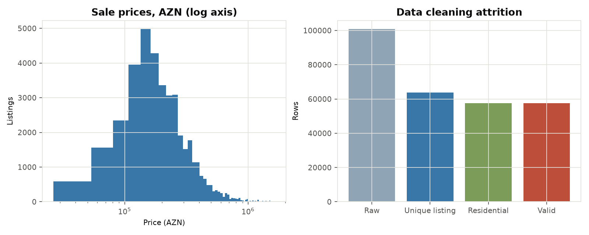
*Figure 1. Cleaning stages and skewed training price distribution.*

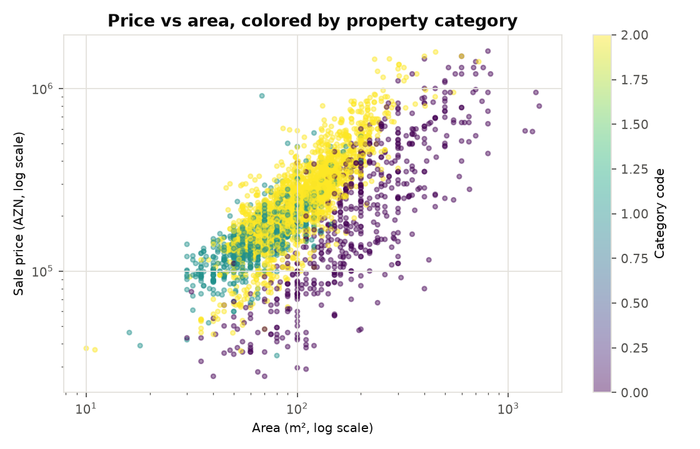
*Figure 2. Price and area on log axes; points are colored by listing category.*

### Exploratory analysis

The raw EDA report is in [`reports/eda/eda_report.txt`](eda/eda_report.txt), with its 16 source-level plots in `reports/eda/figures/`. The model-oriented plots below use cleaned training data. Location medians require at least 100 training listings and are descriptive rather than causal. Numeric correlations describe pairwise association, not independent feature effects.

Tier shares (premium): train 0.501, validation 0.503, test 0.502.

| Numeric field | Missing before imputation (%) |
|---|---|
| rooms | 0.32 |
| lat | 0.00 |
| lng | 0.00 |

| Numeric field | Pearson r with ln(price) |
|---|---|
| log_area_m2 | 0.715 |
| area_per_room | 0.582 |
| rooms | 0.472 |
| n_floors | 0.257 |
| floor | 0.178 |
| distance_to_centre_km | -0.175 |
| lat | -0.150 |
| sold_by_owner | -0.142 |
| is_ground_floor | -0.141 |
| is_top_floor | -0.141 |
| has_repair | -0.137 |
| has_bill_of_sale | 0.069 |
| has_mortgage | 0.066 |
| log_land_ratio | -0.038 |
| has_floor_info | 0.031 |
| lng | 0.024 |
| is_featured | 0.023 |
| log_land_m2 | 0.020 |
| is_vip | 0.012 |
| floor_ratio | -0.010 |

| Location (min 100 rows) | Train n | Median advertised price (AZN) |
|---|---|---|
| Ağ şəhər q. | 590 | 504,000 |
| Mərdəkan q. | 1427 | 395,000 |
| Sahil m. | 327 | 350,000 |
| İçəri Şəhər m. | 472 | 350,000 |
| Nizami m. | 1037 | 325,000 |
| Nardaran q. | 215 | 321,000 |
| 28 May m. | 1454 | 310,000 |
| Nəsimi r. | 1612 | 308,000 |
| Şah İsmayıl Xətai m. | 1681 | 300,000 |
| Elmlər Akademiyası m. | 1740 | 286,000 |

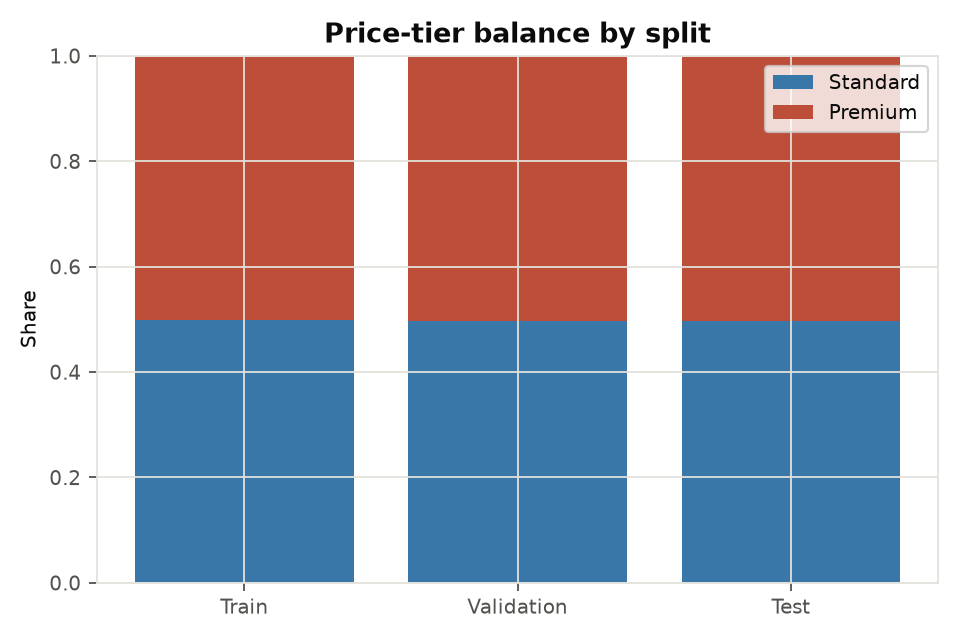
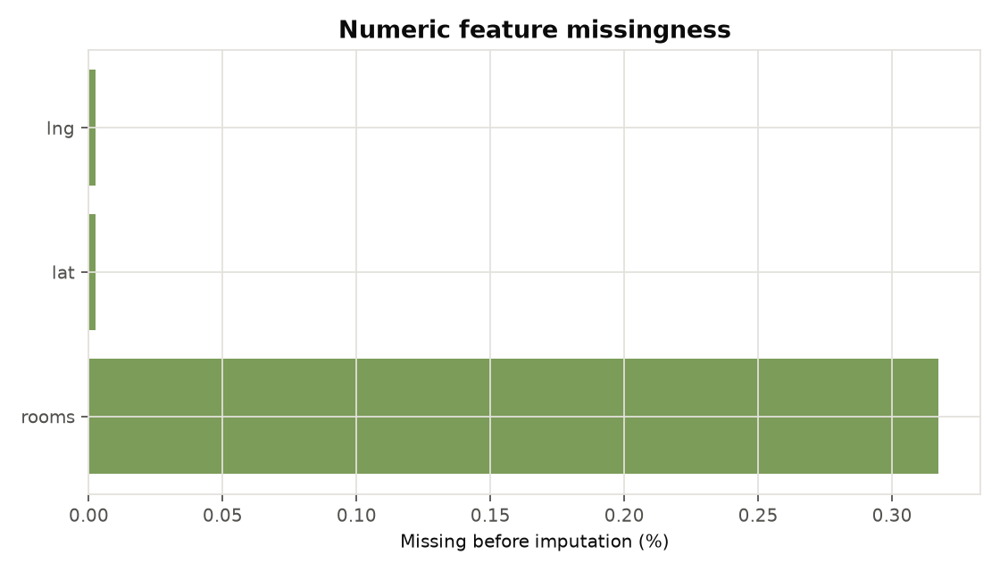
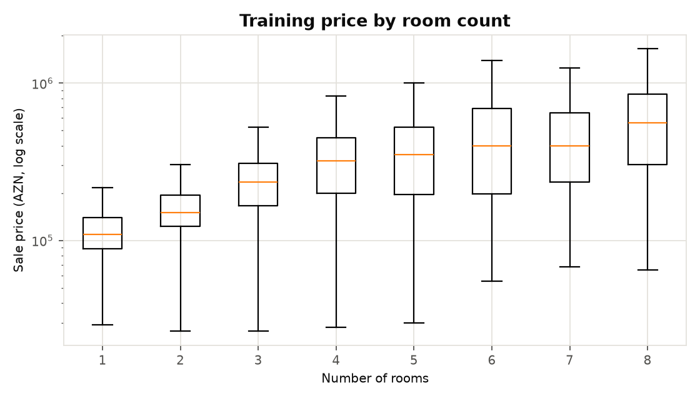
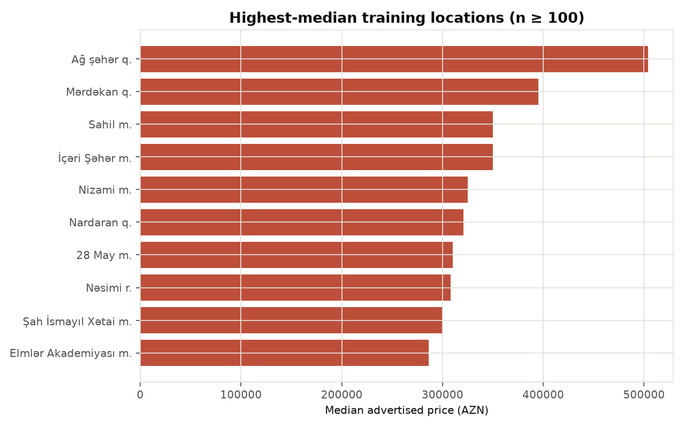
*Figure 3. Additional EDA: class balance, missingness, room-count and location associations.*

## 2. Models built from scratch

### Decision tree

The NumPy tree supports both classification and regression. At each node it sorts each feature once and evaluates all legal boundaries between distinct values using cumulative class counts or target sums/squared sums. Classification split gain is parent impurity minus weighted child impurity, using Gini or entropy. Regression uses MSE reduction (equivalent to variance reduction). Leaves predict the majority class or the mean target. Growth is bounded by maximum depth and minimum split/leaf counts; normalized feature importance sums weighted impurity decrease over internal nodes.

Tree selection uses only validation: Task A sweeps depth `{4, 8, 12, None}` × minimum leaf `{5, 20}`, minimizing log-price RMSE. Task B sweeps Gini/entropy × depth `{4, 8, 12}` × minimum leaf `{5, 20}`, maximizing F1. The selected parameter dictionaries and every validation score are in `results.json`; the full sweep is also tabulated below.

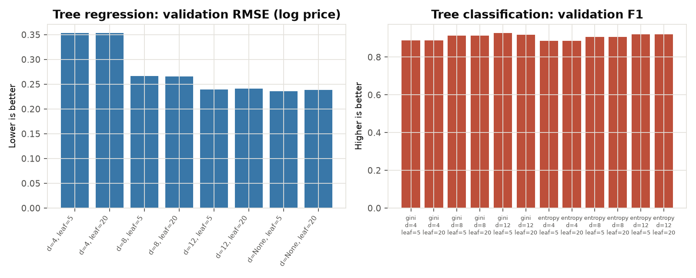
*Figure 4. Validation scores for every tree configuration; selection uses validation only.*

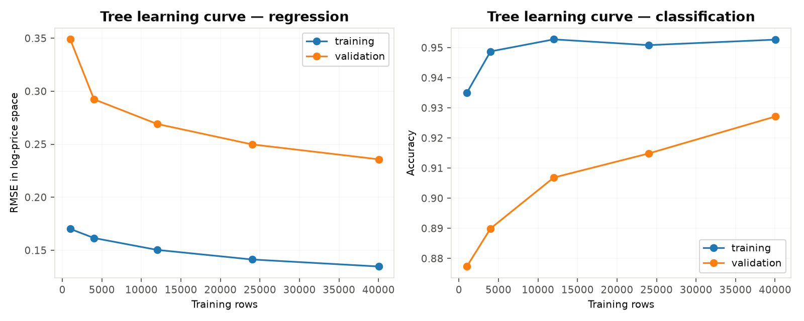
*Figure 5. Training versus validation performance by sample size; the gap illustrates variance/overfit behaviour.*

### Linear and nonlinear SVM

We optimize the regularized hinge-loss primal with Pegasos: `J(w,b) = (lambda/2)||w||² + mean(max(0, 1 − yᵢ(w·xᵢ+b)))`, mapping the two tier labels to −1/+1 internally. At step t, `eta = 1/(lambda*t)`; weights shrink by `(1−eta*lambda)` and violating points add `eta*y*x`. The intercept is unregularized and its per-update step is clipped to `min(eta, 1)` for stability; this is a bounded-bias Pegasos variant, and the difference from an unbounded augmented-vector update is a limitation. Features are standardized using training data. We tune lambda in `{0.001, 0.01, 0.1}` on a seeded 12,000-row training sample and validation F1, then refit the selected linear model on the full training split. We match the scikit-learn LinearSVC using objective-matched `C=1/(lambda*n_train)`.

The required nonlinear alternative is random Fourier feature Pegasos. We draw Gaussian frequencies and uniform phases to map rows to `sqrt(2/D) cos(xW+b)`, which approximates an RBF kernel, then optimize the same primal in that mapped space. We tune RBF gamma `{0.01, 0.1, 1.0}` on a seeded 8,000-row train sample and validation F1. Its reference is sklearn RBF SVC trained on that same subset. This approximation depends on random features and is expected to vary with component count; we fix the seed and use 128 components.

The learned linear margin is `2/||w||`; support vectors are training points with signed margin at most 1. The full norm, margin width and support-vector count are reported in the JSON and below.

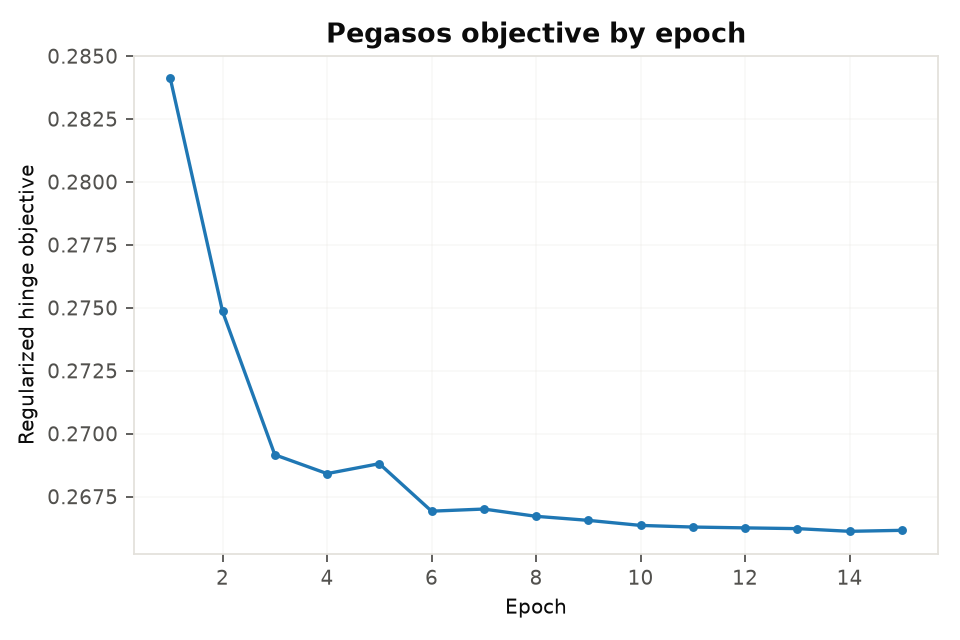
*Figure 6. Regularized hinge objective over epochs for the final linear Pegasos fit.*

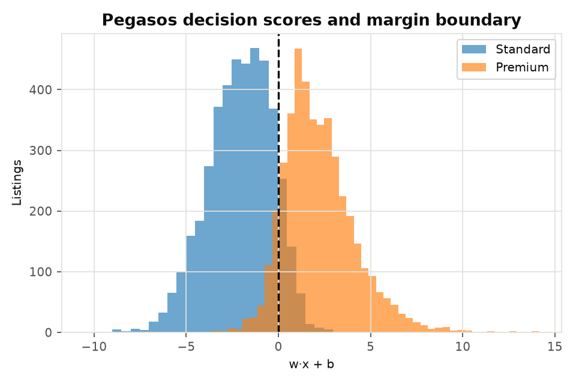
*Figure 7. Signed decision scores; zero is the separating hyperplane and ±1 bounds the margin.*

## 3. Experimental design

Model hyperparameters are selected using validation only, and the test partition is scored after model settings are fixed. The data scope and fixed price/area/price-per-m² bounds were chosen after looking at the full source distribution before training; this is disclosed as a selection limitation, and those bounds were not tuned to test model scores. Tree baselines use scikit-learn `DecisionTreeRegressor`/`DecisionTreeClassifier` on the same full training matrix and matched depth/leaf/criterion settings. The sklearn LinearSVC baseline uses a scaler inside a pipeline, all training rows and objective-matched C. The nonlinear RBF SVC uses the RFF model's tuning subset, matched gamma and corresponding C. These library models are references only; the submitted tree and Pegasos optimization are NumPy implementations.

For uncertainty, we run five-fold CV on all 40,033 post-cleaning training rows (each validation fold is about one fifth; each fold trains on the other four fifths). The selected tree and Pegasos configurations are held fixed in folds. An additional SVM scaler is fitted within each fold. The shared feature matrix's numeric imputation/scaling statistics and categorical vocabulary were fitted on the full training partition before CV; this unsupervised preprocessing means CV dispersion is indicative rather than a fully nested estimate. The independent test partition is excluded from CV and remains the final held-out evaluation.

Regression reports RMSE/MAE/R² in log space and AZN space. Classification reports accuracy, precision, recall, F1, ROC-AUC, confusion matrices and ROC curves. Fit/predict times are wall-clock seconds on the current machine and are informational, not cross-machine guarantees.

## 4. Held-out results

### Task A — regression

| Model | RMSE ln(AZN) | MAE ln(AZN) | R² ln | RMSE AZN | MAE AZN | Median abs error AZN | Max abs error AZN | R² AZN | Fit s | Predict s |
|---|---|---|---|---|---|---|---|---|---|---|
| decision_tree_regression | 0.2386 | 0.1474 | 0.8614 | 147,356 | 47,613 | 16,431 | 3,760,714 | 0.6519 | 5.82 | 0.015 |
| sklearn_tree_regression | 0.2392 | 0.1478 | 0.8607 | 147,683 | 47,780 | 16,450 | 3,760,714 | 0.6504 | 0.28 | 0.003 |

The scratch tree's **47,613 AZN MAE is an average absolute error, not a maximum**. Median absolute error is **16,431 AZN**; the largest test error was **3,760,714 AZN**: a 950 m², 11-room Həyət evi/Bağ evi listing in Nəriman Nərimanov m. priced at 5,000,000 AZN was predicted at 1,239,286 AZN. This is one high-price-tail miss; RMSE penalizes it strongly.

Selected scratch-tree setting: `{"criterion": "mse", "max_depth": null, "depth_label": "None", "min_samples_leaf": 5, "validation_rmse_log": 0.23583588350338835, "validation_mae_log": 0.14518822203657977, "fit_seconds": 5.439315963998524}`. Five-fold CV on all 40,033 training rows gives scratch log-RMSE **0.2355 ± 0.0035** and sklearn **0.2356 ± 0.0031**. In currency space, scratch-tree MAE is **41,505 ± 675 AZN** across folds; matched sklearn MAE is **41,516 ± 696 AZN**. CV MAE is lower than test MAE in part because the folds draw from the MAD-filtered training partition, while the untouched test retains extreme-price listings. These fold averages describe stability; they do not replace the held-out test MAE.

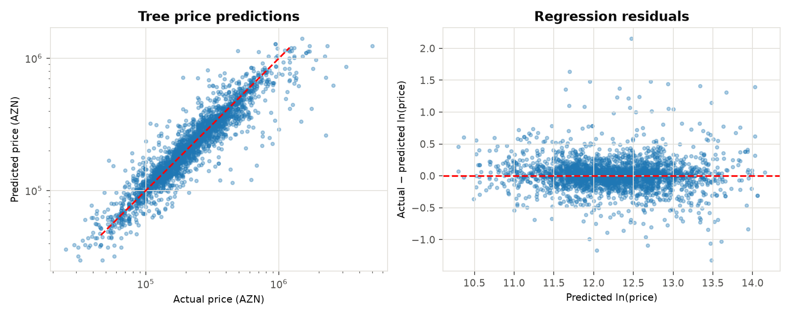
*Figure 8. Held-out predicted versus observed price and residuals in log space.*

### Task B — price-tier classification

| Model | Accuracy | Precision | Recall | F1 | ROC-AUC | Fit s | Predict s |
|---|---|---|---|---|---|---|---|
| decision_tree_classification | 0.9222 | 0.9186 | 0.9271 | 0.9228 | 0.9584 | 1.76 | 0.037 |
| sklearn_tree_classification | 0.9225 | 0.9200 | 0.9262 | 0.9231 | 0.9592 | 0.24 | 0.003 |
| pegasos_svm | 0.9019 | 0.8960 | 0.9103 | 0.9031 | 0.9681 | 2.81 | 0.001 |
| linear_svc | 0.9022 | 0.8957 | 0.9114 | 0.9035 | 0.9684 | 0.48 | 0.005 |
| rff_pegasos_svm | 0.7895 | 0.8029 | 0.7698 | 0.7860 | 0.8751 | 0.82 | 0.052 |
| rbf_svc | 0.8160 | 0.8391 | 0.7841 | 0.8106 | 0.9093 | 1.69 | 4.253 |

Selected scratch tree: `{"criterion": "gini", "max_depth": 12, "depth_label": 12, "min_samples_leaf": 5, "validation_accuracy": 0.9271316033364226, "validation_f1": 0.9275262126973153, "validation_roc_auc": 0.9638410153106274, "fit_seconds": 1.7941338980017463}`. Selected linear lambda: `0.01`. Selected RFF gamma: `0.01`. Tier cutoff: **208,000 AZN** (training median).

Five-fold CV uses all 40,033 training rows: scratch tree accuracy **0.9208 ± 0.0024**, matched sklearn tree **0.9209 ± 0.0031**; Pegasos **0.9056 ± 0.0026**, LinearSVC **0.9060 ± 0.0021**. Each fold trains on four fifths and validates on the remaining fifth. Imputation/scaling/category levels were fit on all training rows before folds, so this CV is not fully nested.

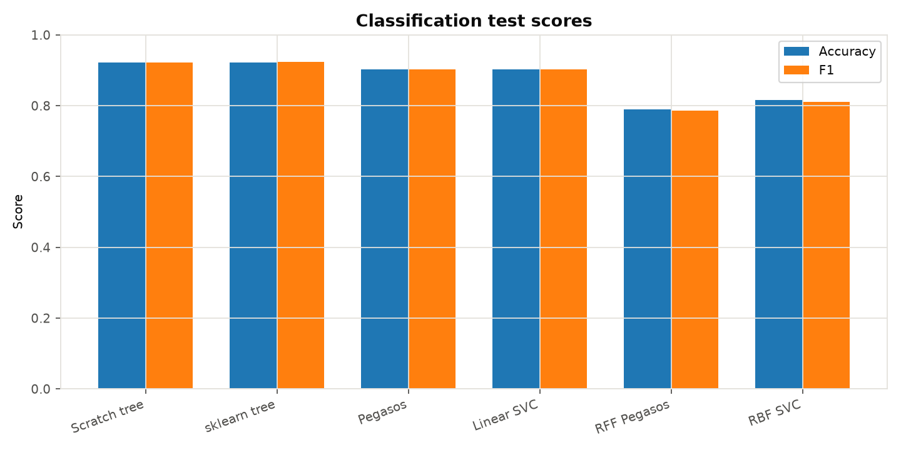
*Figure 9. Accuracy and F1 on the held-out test set.*

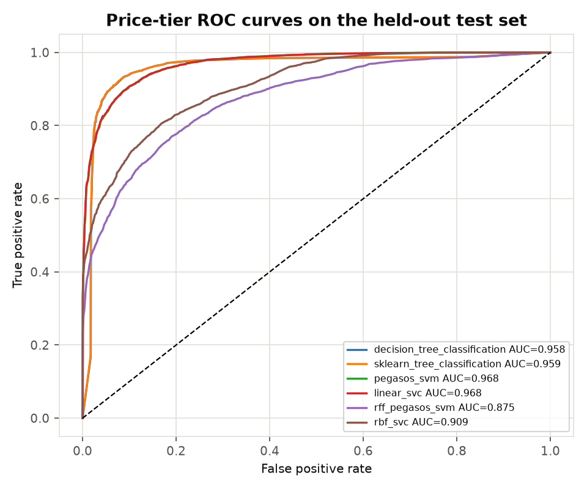
*Figure 10. Tier ROC curves on untouched test rows.*

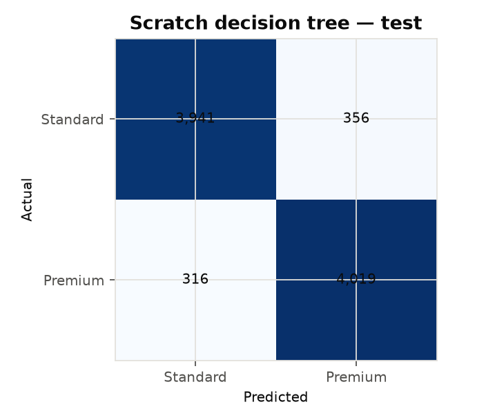

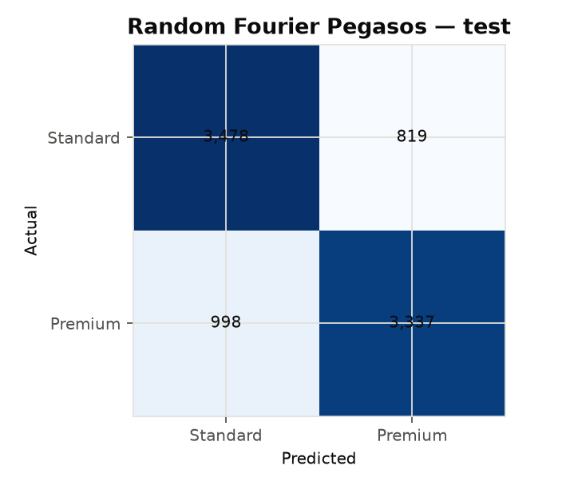
*Figure 11. Test confusion matrices (true rows, predicted columns).*

### Confusion matrices

- **decision_tree_classification:** `[[TN=3941, FP=356], [FN=316, TP=4019]]`; support vectors/points: n/a; margin width: n/a.
- **sklearn_tree_classification:** `[[TN=3948, FP=349], [FN=320, TP=4015]]`; support vectors/points: n/a; margin width: n/a.
- **pegasos_svm:** `[[TN=3839, FP=458], [FN=389, TP=3946]]`; support vectors/points: 11587; margin width: 0.9000651954181157.
- **linear_svc:** `[[TN=3837, FP=460], [FN=384, TP=3951]]`; support vectors/points: 11621; margin width: 0.9035158057945506.
- **rff_pegasos_svm:** `[[TN=3478, FP=819], [FN=998, TP=3337]]`; support vectors/points: 6396; margin width: 0.393964153873699.
- **rbf_svc:** `[[TN=3645, FP=652], [FN=936, TP=3399]]`; support vectors/points: 6294; margin width: n/a.

### Selected tree feature importance

#### Regression

| Rank | Feature | Normalized impurity importance |
|---|---|---|
| 1 | log_area_m2 | 0.53501 |
| 2 | distance_to_centre_km | 0.19589 |
| 3 | area_per_room | 0.07989 |
| 4 | lng | 0.05283 |
| 5 | n_floors | 0.03539 |
| 6 | lat | 0.03092 |
| 7 | log_land_m2 | 0.01425 |
| 8 | floor_ratio | 0.00796 |
| 9 | has_bill_of_sale | 0.00672 |
| 10 | floor | 0.00648 |
| 11 | has_repair | 0.00573 |
| 12 | location=Ağ şəhər q. | 0.00373 |
| 13 | rooms | 0.00332 |
| 14 | log_land_ratio | 0.00322 |
| 15 | location=Binəqədi q. | 0.00214 |

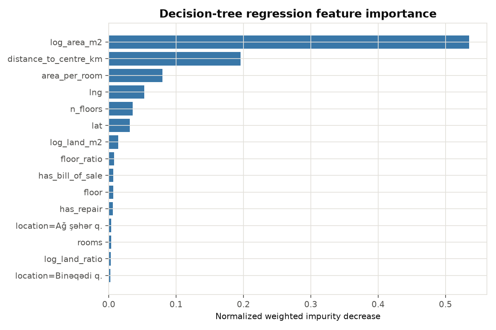
#### Classification

| Rank | Feature | Normalized impurity importance |
|---|---|---|
| 1 | log_area_m2 | 0.56264 |
| 2 | distance_to_centre_km | 0.15291 |
| 3 | lng | 0.05802 |
| 4 | area_per_room | 0.05393 |
| 5 | n_floors | 0.03553 |
| 6 | lat | 0.03168 |
| 7 | floor_ratio | 0.02200 |
| 8 | floor | 0.01377 |
| 9 | log_land_m2 | 0.01117 |
| 10 | has_repair | 0.01073 |
| 11 | location=Ağ şəhər q. | 0.00920 |
| 12 | location=Nəriman Nərimanov m. | 0.00889 |
| 13 | location=Mərdəkan q. | 0.00454 |
| 14 | log_land_ratio | 0.00334 |
| 15 | has_bill_of_sale | 0.00324 |

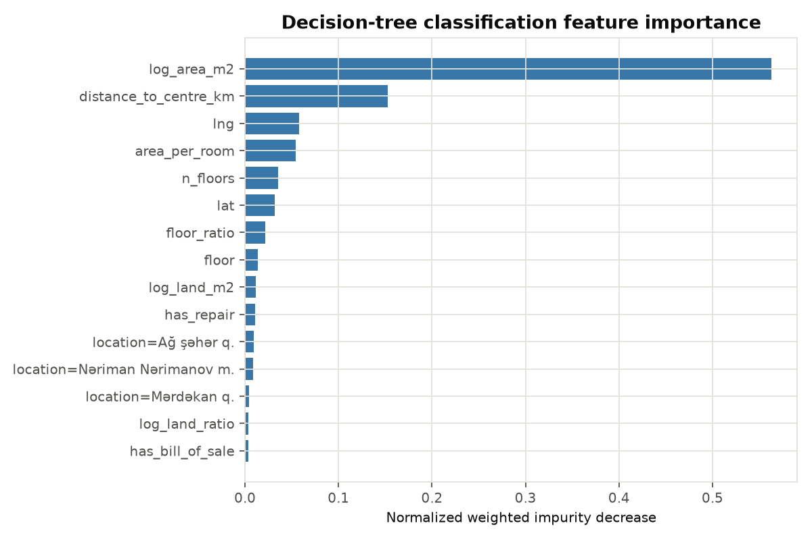

### Regression error slices

| Slice | n | Median actual AZN | MAE AZN | MAE ln(price) |
|---|---|---|---|---|
| training-price-quartile-1 | 2093 | 109,000 | 17,818 | 0.1640 |
| training-price-quartile-2 | 2204 | 171,000 | 20,010 | 0.1132 |
| training-price-quartile-3 | 2119 | 253,000 | 30,895 | 0.1165 |
| training-price-quartile-4 | 2216 | 420,000 | 119,193 | 0.1953 |
| property:Həyət evi/Bağ evi | 1469 | — | 115,825 | 0.3038 |
| property:Köhnə tikili | 1823 | — | 21,030 | 0.1153 |
| property:Yeni tikili | 5340 | — | 37,923 | 0.1153 |

The price-quartile slices use training-set price cutpoints applied to test rows. Property-category slices are shown separately because their prices and sample sizes differ. Currency MAE can be dominated by expensive listings; log MAE shows proportional error more evenly. The plot and slice table should be read together, not as evidence of causal effects.

## 5. Validation sweeps

### Regression tree

| Depth | min leaf | Validation RMSE log | Validation MAE log | Fit s |
|---|---|---|---|---|
| 4 | 5 | 0.35331 | 0.24825 | 0.40 |
| 4 | 20 | 0.35331 | 0.24825 | 0.44 |
| 8 | 5 | 0.26636 | 0.18177 | 0.85 |
| 8 | 20 | 0.26559 | 0.18100 | 0.79 |
| 12 | 5 | 0.23935 | 0.15675 | 1.90 |
| 12 | 20 | 0.24120 | 0.15875 | 1.36 |
| None | 5 | 0.23584 | 0.14519 | 5.44 |
| None | 20 | 0.23888 | 0.15291 | 2.91 |

### Classification tree

| Criterion | Depth | min leaf | Accuracy | F1 | ROC-AUC | Fit s |
|---|---|---|---|---|---|---|
| gini | 4 | 5 | 0.8859 | 0.8881 | 0.9454 | 0.44 |
| gini | 4 | 20 | 0.8859 | 0.8881 | 0.9454 | 0.43 |
| gini | 8 | 5 | 0.9144 | 0.9140 | 0.9703 | 0.98 |
| gini | 8 | 20 | 0.9138 | 0.9133 | 0.9709 | 0.91 |
| gini | 12 | 5 | 0.9271 | 0.9275 | 0.9638 | 1.79 |
| gini | 12 | 20 | 0.9194 | 0.9193 | 0.9728 | 1.37 |
| entropy | 4 | 5 | 0.8820 | 0.8871 | 0.9470 | 0.43 |
| entropy | 4 | 20 | 0.8820 | 0.8871 | 0.9470 | 0.44 |
| entropy | 8 | 5 | 0.9067 | 0.9066 | 0.9696 | 1.00 |
| entropy | 8 | 20 | 0.9059 | 0.9058 | 0.9712 | 0.95 |
| entropy | 12 | 5 | 0.9198 | 0.9206 | 0.9668 | 1.75 |
| entropy | 12 | 20 | 0.9190 | 0.9195 | 0.9734 | 1.40 |

### Pegasos and RFF

| Model sweep | Hyperparameter | Accuracy | F1 | ROC-AUC | Train subset | Fit s |
|---|---|---|---|---|---|---|
| Linear Pegasos | lambda=0.001 | 0.9005 | 0.9016 | 0.9652 | 12000 | 1.12 |
| Linear Pegasos | lambda=0.01 | 0.9079 | 0.9089 | 0.9693 | 12000 | 0.99 |
| Linear Pegasos | lambda=0.1 | 0.8983 | 0.9000 | 0.9648 | 12000 | 1.26 |
| RFF Pegasos | gamma=0.01 | 0.7814 | 0.7730 | 0.8691 | 8000 | 0.70 |
| RFF Pegasos | gamma=0.1 | 0.6864 | 0.6442 | 0.7610 | 8000 | 0.72 |
| RFF Pegasos | gamma=1.0 | 0.4973 | 0.0018 | 0.5721 | 8000 | 0.72 |

## 6. Discussion: what went wrong and what worked

- **Performance is useful but not appraisal-grade.** The scratch tree's log-price MAE is `0.147`; its raw-price MAE is `47,613 AZN` and its largest absolute test error is `3,760,714 AZN`. These are distinct statistics. Test R² in raw AZN is `0.652`; the high-price tail remains difficult even with log training.
- **The tier problem is easier than exact valuation.** The tree and Pegasos both achieve F1 near `0.92` against a balanced median label. Because area, property type, location and price are correlated, this should not be interpreted as causal price explanation.
- **A modest scratch/reference gap is expected.** The reference trees and SVC use the same split and matched hyperparameters, but tie-breaking, floating-point boundaries, and implementation details can differ. We report those differences instead of claiming equality.
- **Bias and variance are visible in learning curves.** Small training sets have larger train/validation gaps. Depth/min-leaf tuning controls variance; unlimited depth is intentionally excluded from the candidate set to reduce overfit risk.
- **Sparse locations and asking-price labels limit transfer.** Rare neighborhoods share an `other` level; these models predict advertised prices, not completed transactions.
- **The RFF result is approximate.** It uses 128 seeded random components and an 8,000-row training subset for runtime. It is a genuine nonlinear NumPy Pegasos pipeline but should not be mistaken for exact RBF optimization.
- **Potential selection bias remains.** This is a scraped listing dataset, not verified closing transactions; advertised prices can differ from sale prices. The single snapshot also reflects the 2024 market and cannot support present-day valuation without fresh data.

## 7. Automated tests

The complete `pytest -vv` run finished with: **249 passed in 15.37s**. The full test-by-test terminal output is in [`reports/test_results.txt`](test_results.txt). The suite covers both tree tasks and split criteria, Pegasos input/learning/objective behavior, the nonlinear RFF model, visualization exports, metric parity, measurement parsing, advert-ID deduplication, scope/domain filtering, saved processed artifacts, finite prepared matrices and normalized tree feature importances.

## 8. Reproducibility and files

From the repository root, install pinned requirements, place the dataset at `data/bina_az_sale.csv`, then run `python -m src.run_all`. It regenerates `reports/results.json`, all report figures, this Markdown report, `report/report.tex`, and the two-column `report/report.pdf`. Run `pytest -q` to execute the model, visualization and data-preparation tests. The data archive is excluded from version control.

## 9. Four-person contribution and presentation plan

| Speaker | Owned deliverables | Presentation scope | Effort target |
|---|---|---|---|
| Emiliya Abdulhalimova — data engineering | Raw EDA, cleaning decisions, leakage audit, processed splits and feature engineering | Problem, dataset, EDA evidence, preprocessing and split | 25% |
| Aygun Asvarova — decision trees | NumPy classification/regression trees, Gini/entropy/MSE, tuning and tree diagnostics | Tree math, implementation, validation sweep and feature interpretation | 25% |
| Murad Bagirzade — SVM | NumPy Pegasos, hinge objective, scaling, margins, support vectors and RFF extension | SVM updates, convergence evidence, linear/nonlinear comparison | 25% |
| Kanan Karimli — evaluation/reproducibility | Matched baselines, metrics, CV, error analysis, tests, reports and run instructions | Fair benchmark, results, limitations and reproducible handoff | 25% |

The plan targets equal effort and equal speaking time (about 3–4 minutes each in a 14-minute presentation). Each speaker owns a substantive technical workstream with analysis/results, rather than assigning one person only formatting. These are proposed presentation/work allocations; record actual completed contributions honestly in `contribution_report.md`. Cross-review another member’s module so all four can explain the end-to-end pipeline.

## 10. AI-assistance disclosure

AI was used as a coding assistant for suggestions, debugging, corrections, review, tests, visualizations, and documentation. The PegaSold team is responsible for checking the final code, results, and explanations. The decision-tree and Pegasos algorithms are implemented in the project’s NumPy code; scikit-learn is used for comparison models and standard utilities. The dataset was supplied separately by the course/team and is not included in the repository.

## 11. Figures

- `class_balance.png`
- `classification_comparison.png`
- `data_and_prices.png`
- `decision_tree.png`
- `feature_importance_classification.png`
- `feature_importance_regression.png`
- `location_prices.png`
- `missingness.png`
- `pegasos_confusion_matrix.png`
- `pegasos_objective.png`
- `price_vs_area.png`
- `price_vs_rooms.png`
- `regression_error_analysis.png`
- `rff_confusion_matrix.png`
- `roc_curves.png`
- `svm_margin_scores.png`
- `tree_confusion_matrix.png`
- `tree_learning_curves.png`
- `tree_tuning.png`

## Appendix A — Raw-data exploration figures

These 16 figures accompany the complete raw-source analysis in Appendix B. They are descriptive plots; the model results above come from the processed train/validation/test partitions.

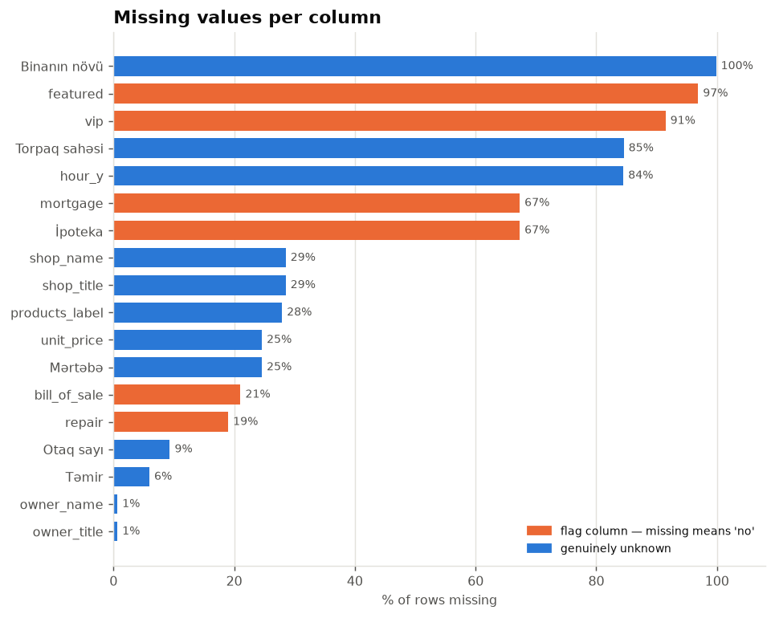

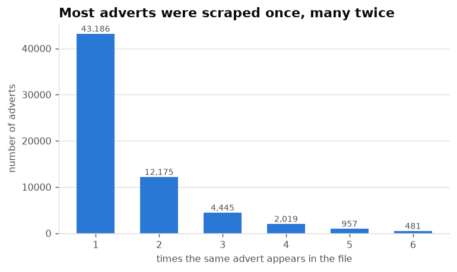

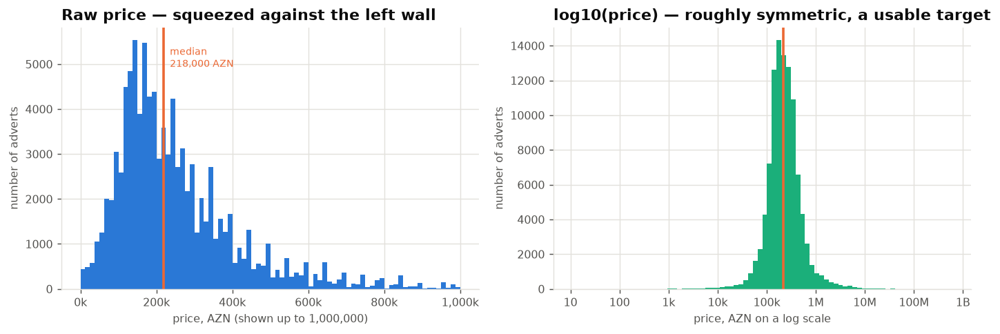

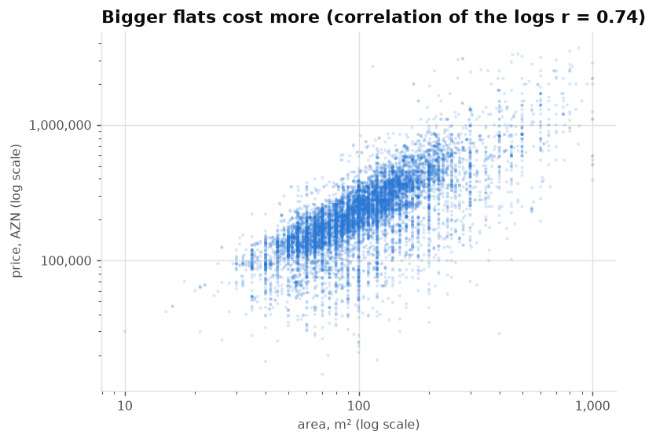

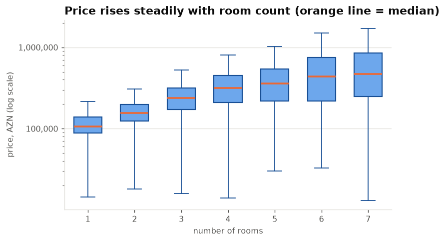

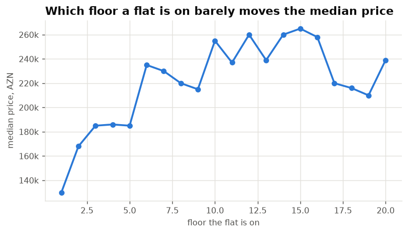

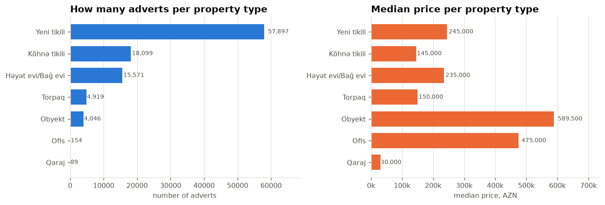

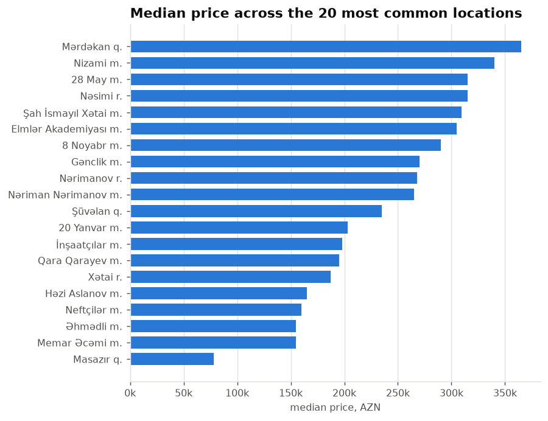

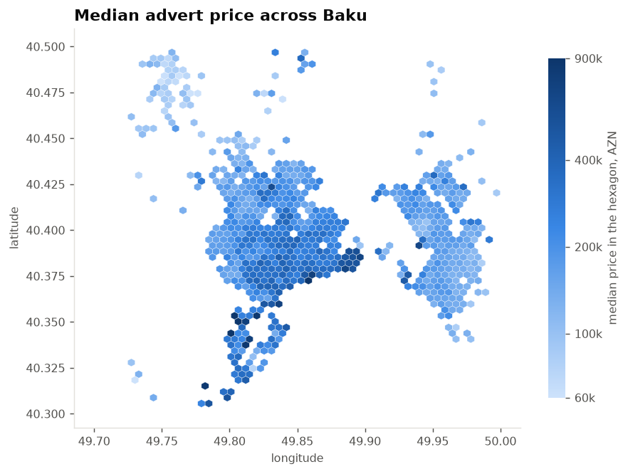

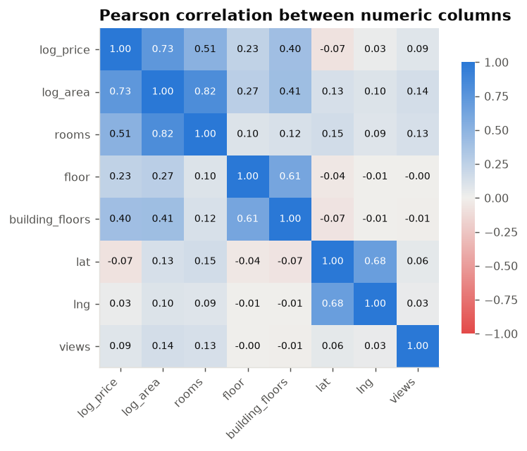

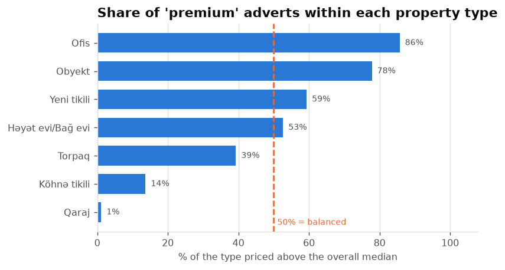

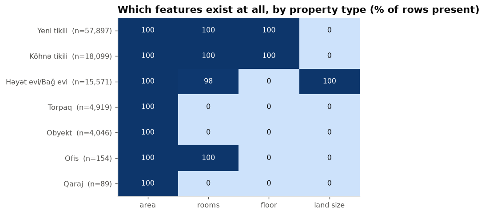

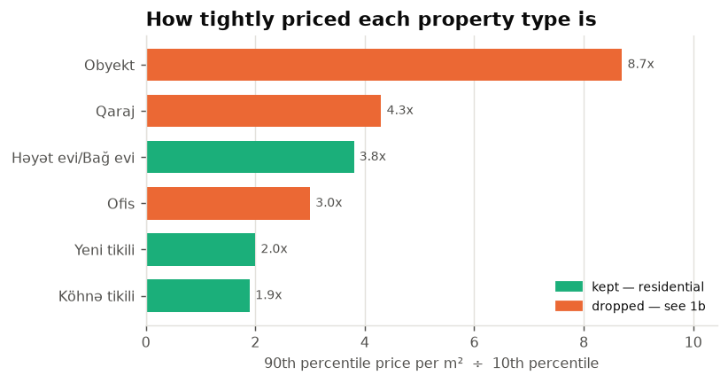

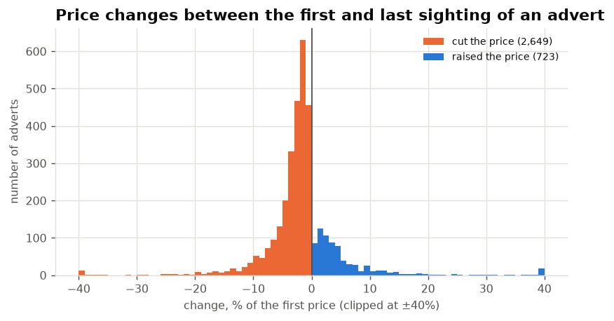

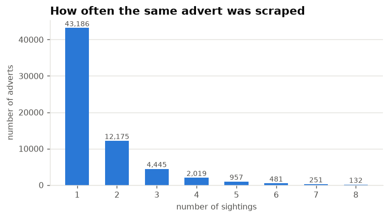

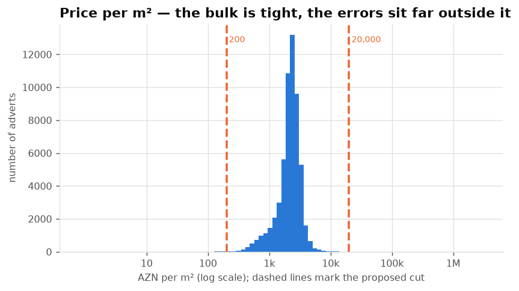

## Appendix B — Complete raw-data EDA transcript

```text
bina.az sale — exploratory data analysis
source file: data/bina_az_sale.csv
read-only analysis; source CSV is not modified

==============================================================================
1. OVERVIEW — how big is the data and what are the columns?
==============================================================================
Rows:    100,775
Columns: 51
Memory:  431 MB in RAM

Every column, its type, how much is missing, and how many distinct
values it holds. A column with 1 distinct value carries no information;
a column with ~1 distinct value per row is an identifier.

                       dtype  missing_%  n_unique                                         example
id_x                     str        0.0    100775            5df36281-6dc6-4d5d-89a7-5fcfa86f7608
rel_url                  str        0.0       411                            /alqi-satqi?page=174
estate_rel_url_x         str        0.0     64454                                  /items/4521724
datetime_scrape_x        str        0.0        36                    2024-10-05 22:07:37.60613+00
price                float64        0.0      2772                                        499999.0
currency_x               str        0.0         1                                             AZN
location                 str        0.0       142                                       Səbail r.
attributes               str        0.0     21347                   4 otaqlı, 145 m², 7/9 mərtəbə
city_when                str        0.0      1504                               Bakı, dünən 23:52
city                     str        0.0         8                                            bakı
day_x                    str        0.0        36                                      05.10.2024
hour_x                   str        0.0      1226                                           23:52
repair                   str       19.0         1                                         Təmirli
vip                      str       91.5         1                                          vipped
featured                 str       96.9         1                                        featured
products_label           str       27.9         2                                        Agentlik
bill_of_sale             str       21.0         1                                     Çıxarış var
mortgage                 str       67.3         1                                     İpoteka var
img_url                  str        0.0     64990  https://bina.azstatic.com/uploads/f460x345/20…
id_y                     str        0.0    100775            92e82ea2-e1f3-4c2d-a284-151efd99281e
estate_id                str        0.0    100775            5df36281-6dc6-4d5d-89a7-5fcfa86f7608
estate_rel_url_y         str        0.0     64454                                  /items/4521724
datetime_scrape_y        str        0.0       152                   2024-10-05 22:14:10.089116+00
description              str        0.3     63385  Səbail Rayonu, İzzət Nəbiyev küçəsi, Fəxri Xi…
unit_price               str       24.6       814                                    3 450 AZN/m²
total_price          float64        0.0      2772                                        499999.0
currency_y               str        0.0         1                                             AZN
owner_name               str        0.7      5448                                          Kamran
owner_title              str        0.7         2                                     mülkiyyətçi
shop_name                str       28.5       316                                      Elite Ofis
shop_title               str       28.5         1                        Daşınmaz əmlak agentliyi
address                  str        0.0     16716                              İzzət Nəbiyev küç.
lat                  float64        0.0     57991                               40.35881658415597
lng                  float64        0.0     57207                               49.82409207076296
updated                  str        0.0      1145                         yeniləndi: dünən 23:52 
views                  int64        0.0      5896                                            1155
day_y                    str        0.0        38                                      05.10.2024
hour_y                   str       84.5      1028                                           23:52
estate_details_id_x      str        0.0    100775            92e82ea2-e1f3-4c2d-a284-151efd99281e
Binanın növü             str       99.8         3                                     Ev / Mənzil
Kateqoriya               str        0.0         7                                    Köhnə tikili
Mərtəbə                  str       24.6       392                                           7 / 9
Otaq sayı            float64        9.3        19                                             4.0
Sahə                     str        0.0      1804                                          145 m²
Torpaq sahəsi            str       84.5       188                                         1.3 sot
Təmir                    str        6.0         2                                             var
Çıxarış                  str        0.0         2                                             var
İpoteka                  str       67.3         1                                             var
estate_details_id_y      str        0.0    100775            92e82ea2-e1f3-4c2d-a284-151efd99281e
estate_rel_url           str        0.0     64454                                  /items/4521724
extra_info               str        0.0      3000   Şəhidlər xiyabanı * Dağüstü parkı * Səbail r.

Constant columns (one value only, useless as features): ['currency_x', 'repair', 'vip', 'featured', 'bill_of_sale', 'mortgage', 'currency_y', 'shop_title', 'İpoteka']
Identifier-like columns (nearly unique per row):        ['id_x', 'id_y', 'estate_id', 'estate_details_id_x', 'estate_details_id_y']

==============================================================================
2. MISSING VALUES — and whether 'missing' really means 'unknown'
==============================================================================
Percentage missing per column (highest first, only columns > 0):
Binanın növü      99.8
featured          96.9
vip               91.5
Torpaq sahəsi     84.5
hour_y            84.5
İpoteka           67.3
mortgage          67.3
shop_title        28.5
shop_name         28.5
products_label    27.9
unit_price        24.6
Mərtəbə           24.6
bill_of_sale      21.0
repair            19.0
Otaq sayı          9.3
Təmir              6.0
owner_name         0.7
owner_title        0.7
description        0.3

THE TRAP. Some columns are never written as 'no'. The scraper only
records them when the answer is 'yes', so NaN means 'no', not 'unknown'.
Check: every one of these columns has exactly ONE distinct value.

  vip            distinct non-missing values = ['vipped']   present in   8.5% of rows
  featured       distinct non-missing values = ['featured']   present in   3.1% of rows
  repair         distinct non-missing values = ['Təmirli']   present in  81.0% of rows
  bill_of_sale   distinct non-missing values = ['Çıxarış var']   present in  79.0% of rows
  mortgage       distinct non-missing values = ['İpoteka var']   present in  32.7% of rows
  İpoteka        distinct non-missing values = ['var']   present in  32.7% of rows

So these must be filled with 0/1, NOT dropped and NOT imputed with a
mean. Dropping rows where 'vip' is missing would delete 91% of the data
for no reason.
    [figure] /home/kanan/PycharmProjects/PegaSold/reports/eda/figures/fig01_missing_values.png

==============================================================================
3. DUPLICATES — is every row a different flat?
==============================================================================
Identical rows (all 51 columns equal): 0

But each advert has a stable page address in `estate_rel_url_x`
(e.g. /items/4521724). If the same address appears twice, the same
flat was scraped twice.
  rows in file:            100,775
  distinct adverts:        63,785
  extra (repeat) rows:     36,990  = 36.7% of the file

How many times each advert appears:
       adverts
count         
1        43186
2        12175
3         4445
4         2019
5          957
6          481
7          251
8          132
9           84
10          35
11          10
12           6
13           3
17           1

Does the price change between the copies of one advert?
  adverts with a single price across their copies: 60,376
  adverts whose price changed:                     3,409

WHY THIS MATTERS. If we split the data randomly without removing these,
the same flat can land in both train and test. The model then recalls a
price it has already seen and the test score is a lie.
    [figure] /home/kanan/PycharmProjects/PegaSold/reports/eda/figures/fig02_duplicate_adverts.png

==============================================================================
4. LEAKAGE — which columns already contain the answer?
==============================================================================
A feature leaks if it could only be known once the price is known.
Training on one makes the score perfect and the model worthless.

`total_price` equals `price` in 99.99% of rows.
  -> it is the target under a second name. DROP.

`unit_price` is price per m². On the 75,996 rows where both it
and the area are present, unit_price x area reconstructs the price:
  within  1% of the true price: 100.0% of rows
  within  5% of the true price: 100.0% of rows
  -> it is the target divided by a feature we keep. DROP.

`description` is free text written by the seller and very often states
the price in words. Treat as leakage unless the price is stripped out:
  17% of a 4,000-row sample mention a price word.

VERDICT — drop before training: total_price, unit_price, description.

==============================================================================
5. THE TARGET `price` — what are we predicting?
==============================================================================
Summary in AZN:
count        100,775
mean         342,356
std        2,042,627
min               11
1%            28,000
5%            70,000
25%          145,000
50%          218,000
75%          338,000
95%          770,000
99%        2,500,000
max      600,000,000

The mean (342,356) is far above the median (218,000).
That gap is the signature of a long right tail: a few enormous values
drag the average up. Look at both ends:

  cheapest 10 prices: [11.0, 73.0, 127.0, 250.0, 400.0, 400.0, 700.0, 800.0, 999.0, 999.0]
  priciest 5 prices:  ['600,000,000', '60,000,000', '40,000,000', '39,000,000', '36,000,000']

  rows priced under 1,000 AZN:      10
  rows priced over 10,000,000 AZN:  101
  These are data-entry errors or whole buildings, not flats. A flat
  does not cost 11 AZN. data_prep should cut an explicit price window
  and the report must name the cut.

WHY log(price). Prices span six orders of magnitude. In AZN, one
mistake on a 10,000,000 flat outweighs thousands of ordinary flats, so
squared error chases the outliers. log(price) turns 'twice as
expensive' into a constant step, which is how people compare houses,
and makes the distribution close to symmetric — see the figure.
    [figure] /home/kanan/PycharmProjects/PegaSold/reports/eda/figures/fig03_price_distribution.png

==============================================================================
6. NUMERIC FEATURES — ranges, nonsense values, and the link to price
==============================================================================
Price and floor-area comparisons use residential listings only. Bare-land
`Sahə` is measured in sot, so it is not comparable to residential m².
The raw file hides numbers inside text ('145 m²', '7 / 9'). After
unpacking them:

       area_m2     rooms    floor  building_floors  land_sot     views       lat       lng
count  91567.0  91209.00  75996.0          75996.0   15571.0  91567.00  91567.00  91567.00
mean     125.9      3.13     7.85            13.56     11.57    662.46     40.41     49.88
std     106.44      1.36     4.89             5.45     298.5   1465.13      0.08      0.27
min        1.0      1.00      1.0              1.0       0.1     23.00     32.69     12.59
1%        35.0      1.00      1.0              3.0       0.6     38.00     40.33     49.74
50%      100.0      3.00      7.0             16.0       4.0    244.00     40.40     49.85
99%      560.0      8.00     20.0             27.0      67.3   6222.04     40.57     50.21
max     3600.0     20.00     27.0             33.0   36000.0  67558.00     41.76     50.34

Impossible or implausible values that data_prep must handle:
  area <= 5 m²:                   2
  area > 1,000 m²:                108
  floor above building height:    0
  rooms > 10:                     224
  coordinates outside Azerbaijan: 4

`views` is how many people opened the advert. It is recorded AFTER the
advert goes live, so it is not something you know about a flat you are
about to price. Treat it as unusable for an honest model.
    [figure] /home/kanan/PycharmProjects/PegaSold/reports/eda/figures/fig04_area_vs_price.png

Correlation between log(area) and log(price) = 0.74. Strong and
close to a straight line on log axes, which is the clearest single
argument for modelling log(price) rather than price.
    [figure] /home/kanan/PycharmProjects/PegaSold/reports/eda/figures/fig05_rooms_vs_price.png
    [figure] /home/kanan/PycharmProjects/PegaSold/reports/eda/figures/fig06_floor_vs_price.png

Median price by floor is nearly flat — floor is a weak feature on its
own. Ground floor and top floor are the only ones that stand out.

==============================================================================
7. CATEGORICAL FEATURES — how many groups, and do they separate price?
==============================================================================
For a feature to be useful, its groups must have different prices.
We judge that with the median price per group (the median ignores the
few huge outliers that would wreck a mean).

--- Kateqoriya ---
                    rows  median_price
Kateqoriya                            
Həyət evi/Bağ evi  15571      235000.0
Köhnə tikili       18099      145000.0
Obyekt              4046      589500.0
Ofis                 154      475000.0
Qaraj                 89       30000.0
Torpaq              4919      150000.0
Yeni tikili        57897      245000.0

--- Təmir ---
         rows  median_price
Təmir                      
var     81612      210000.0
yoxdur  13162      270000.0
NaN      6001      170000.0

--- Çıxarış ---
          rows  median_price
Çıxarış                     
var      79565      218000.0
yoxdur   21210      215000.0

--- İpoteka ---
          rows  median_price
İpoteka                     
var      32939      223000.0
NaN      67836      215000.0

--- owner_title ---
                   rows  median_price
owner_title                          
mülkiyyətçi       10385      159500.0
vasitəçi (agent)  89733      224000.0
NaN                 657      395352.0

--- products_label ---
                 rows  median_price
products_label                     
Agentlik        71981      235000.0
Kompleks          649      396090.0
NaN             28145      167000.0

--- city ---
               rows  median_price
city                             
astara           22       80000.0
ağdam             3       25000.0
bakı         100436      218000.0
gədəbəy           3       39000.0
naxçıvan mr       6       71000.0
sumqayıt          4       68000.0
xaçmaz          103       69000.0
xırdalan        198       93750.0

`location` holds 142 different district/metro
names. One-hot encoding all of them would add that many columns, most
of them almost always zero. data_prep should keep the frequent ones and
fold the rest into a single 'other' bucket.

REDUNDANCY CHECK — some pairs of columns say the same thing twice:
  repair        notna  vs  Təmir == 'var'   agree on 100.0% of rows
  bill_of_sale  notna  vs  Çıxarış == 'var'   agree on 100.0% of rows
  mortgage      notna  vs  İpoteka == 'var'   agree on 100.0% of rows
  -> keep one of each pair, drop the other.
    [figure] /home/kanan/PycharmProjects/PegaSold/reports/eda/figures/fig07_property_type.png
    [figure] /home/kanan/PycharmProjects/PegaSold/reports/eda/figures/fig08_location_vs_price.png

Across those 20 locations the median price runs from 78,000 to 365,000 AZN — a 4.7x spread. Location is a strong feature.

==============================================================================
8. GEOGRAPHY — do the coordinates make sense, and do they matter?
==============================================================================
Coordinates inside Azerbaijan: 100,771 (100.00%)
Coordinates outside:           4
  A listing in Baku cannot sit at longitude 12°. Those rows have a
  broken coordinate; the rest of the row may still be fine, so
  data_prep should blank the coordinate rather than delete the row.
    [figure] /home/kanan/PycharmProjects/PegaSold/reports/eda/figures/fig09_map_of_baku.png

The map shows a clear, smooth price gradient: dark hexagons (expensive)
sit in the city centre by the bay and fade outwards in every direction.
Latitude and longitude therefore carry real signal — but
as a pair, not individually, which a decision tree handles well
(it can cut on both) and a linear SVM handles poorly.

==============================================================================
9. CORRELATION — which numeric columns move together?
==============================================================================
Pearson correlation measures straight-line agreement between two
columns: +1 move together, 0 unrelated, -1 move oppositely. We use
log(price) and log(area) because both are heavily skewed.

                 log_price  log_area  rooms  floor  building_floors   lat   lng  views
log_price             1.00      0.73   0.51   0.23             0.40 -0.07  0.03   0.09
log_area              0.73      1.00   0.82   0.27             0.41  0.13  0.10   0.14
rooms                 0.51      0.82   1.00   0.10             0.12  0.15  0.09   0.13
floor                 0.23      0.27   0.10   1.00             0.61 -0.04 -0.01  -0.00
building_floors       0.40      0.41   0.12   0.61             1.00 -0.07 -0.01  -0.01
lat                  -0.07      0.13   0.15  -0.04            -0.07  1.00  0.68   0.06
lng                   0.03      0.10   0.09  -0.01            -0.01  0.68  1.00   0.03
views                 0.09      0.14   0.13  -0.00            -0.01  0.06  0.03   1.00

Reading it: area and rooms both track price strongly, and they track
each other strongly too — they partly repeat the same information.
`views` is near zero, another reason to leave it out.
    [figure] /home/kanan/PycharmProjects/PegaSold/reports/eda/figures/fig10_correlation.png

==============================================================================
10. TASK B PREVIEW — the premium / standard split
==============================================================================
This is a whole-source descriptive illustration only. The model uses
a separately computed training-set median and >= for the premium label.
For this chart only, the whole-file median is 218,000 AZN:
  standard (<= median): 50,525  (50.1%)
  premium  (>  median): 50,250  (49.9%)

These descriptive labels do not enter the model or held-out evaluation.

Share of premium adverts inside each property type:
                   premium_share   rows
Kateqoriya                             
Ofis                        85.7    154
Obyekt                      77.8   4046
Yeni tikili                 59.3  57897
Həyət evi/Bağ evi           52.7  15571
Torpaq                      39.3   4919
Köhnə tikili                13.7  18099
Qaraj                        1.1     89
    [figure] /home/kanan/PycharmProjects/PegaSold/reports/eda/figures/fig11_price_tiers.png

==============================================================================
11. SCOPE DECISION — which rows belong in the task at all?
==============================================================================
`Kateqoriya` mixes seven kinds of property. The question is whether
they are one prediction problem or several. Three measurements.

1a. THE `Sahə` COLUMN DOES NOT USE ONE UNIT.
Reading the text, not just the number:

                  unit example
Kateqoriya                    
Həyət evi/Bağ evi   m²   90 m²
Köhnə tikili        m²  145 m²
Obyekt              m²  130 m²
Ofis                m²  270 m²
Qaraj               m²   36 m²
Torpaq             sot  12 sot
Yeni tikili         m²  100 m²

`Torpaq` (bare land) measures area in SOT, everybody else in m².
1 sot = 100 m². A naive numeric parse puts '12 sot' (1,200 m²) and
'65 m²' in the same column as 12 and 65, so the plot of land looks
five times SMALLER than the flat. This is silent: nothing crashes,
the model simply learns nonsense.

1b. THE CATEGORIES DO NOT SHARE A FEATURE SET.
Percentage of rows where each feature is present:

                    rows   area  rooms  floor  land size
Kateqoriya                                              
Yeni tikili        57897  100.0  100.0  100.0        0.0
Köhnə tikili       18099  100.0  100.0  100.0        0.0
Həyət evi/Bağ evi  15571  100.0   97.7    0.0      100.0
Torpaq              4919  100.0    0.0    0.0        0.0
Obyekt              4046  100.0    0.0    0.0        0.0
Ofis                 154  100.0  100.0    0.0        0.0
Qaraj                 89  100.0    0.0    0.0        0.0

These are not gaps to impute. A plot of land HAS no floor and HAS no
rooms; the question does not apply. Training one model across all
seven means most of the feature matrix is structurally empty.
    [figure] /home/kanan/PycharmProjects/PegaSold/reports/eda/figures/fig12_feature_availability.png

1c. PRICE PER m² IS CONSISTENT WITHIN FLATS, WILD ACROSS THE REST.
If a category is one coherent market, its price per m² should sit in
a narrow band. We measure the band as the 90th percentile divided by
the 10th: '1.9' means the dear end is 1.9x the cheap end.

                      p10  median     p90  p90 / p10
Kateqoriya                                          
Köhnə tikili       1658.0  2253.0  3111.0        2.0
Yeni tikili        1641.0  2404.0  3357.0        2.0
Ofis               1928.0  3143.0  5862.0        3.0
Həyət evi/Bağ evi   578.0  1225.0  2212.0        4.0
Qaraj               644.0  1333.0  2750.0        4.0
Obyekt             1100.0  3300.0  9571.0        9.0

Flats are the tightest (1.9-2.0x). Houses are looser at 3.8x, because
a house's worth is partly its plot, and plot size varies hugely — but
houses DO record their land size, so that spread is explainable with
the columns we have. `Obyekt` at 8.7x is not: what a commercial unit
earns is nowhere in this file.

`Torpaq` is excluded from the table because its area is in sot, so a
price per m² would be a hundredfold wrong. Measured in its own unit
(AZN per sot) land still spreads 24x from its 10th to its 90th percentile — because what a plot is worth
depends on permission to build on it, which is not in this dataset.
    [figure] /home/kanan/PycharmProjects/PegaSold/reports/eda/figures/fig13_price_consistency.png

1d. WHAT EACH SCOPE COSTS IN ROWS (counted after deduplication).

             adverts
city                
bakı           63523
xırdalan         142
xaçmaz            87
astara            17
naxçıvan mr        6
sumqayıt           4
ağdam              3
gədəbəy            3

                                     adverts kept  % of adverts
everything                                  63785         100.0
Baku only                                   63523          99.6
Baku + residential (flats & houses)         57609          90.3
Baku + apartments only                      48105          75.4

RECOMMENDATION. Keep Baku + the three residential types
(57,609 of 63,785 normalized unique advert IDs, 90.3%).
  - 262 unique IDs are outside Baku; this project
    makes a deliberately Baku-specific prediction task.
  - 5,986 unique IDs are outside the three residential categories;
    land uses sot while residential floor area uses m², and other categories
    often lack rooms/floor. This is a scope choice, not a claim that those
    listings are invalid.
  - the three residential types share one feature set and price per m²
    bands of 1.9-3.8x, so they are one problem.
  - `Kateqoriya` stays as a feature, so the model can still tell a
    house from a new-build flat.

==============================================================================
12. DEDUPLICATION DECISION — one row per advert, but which copy?
==============================================================================
The file was scraped repeatedly between 05 Oct 2024 and 19 Nov 2024
(45 days). A normalized item ID may appear
on multiple scrape days. The repeated-row share is
36.7%; these are
repeat observations of an advert, not necessarily distinct properties.

2a. WHAT CHANGES BETWEEN THE COPIES OF ONE ADVERT?
For every column, the share of repeated adverts where that column
takes more than one value:

views          100.0
lng             41.8
lat             40.2
price           16.5
vip              9.8
description      8.1
Sahə             1.8
Mərtəbə          1.1
Otaq sayı        0.4
location         0.2
Təmir            0.1
Kateqoriya       0.1

The table above shows which values change and how often. Repeated IDs
are the same advert observed at different moments; retaining the last
dated row defines the final observed asking price, not a completed sale.

2b. WHEN THE PRICE MOVES, WHICH WAY DOES IT GO?
  adverts observed more than once: 20,599
  of those, the price changed:     3,372
     price went DOWN: 2,649 (79%)
     price went UP:   723 (21%)

Size of the change, in percent of the first price:
count    3372.0
mean        1.1
std       122.3
min       -90.0
10%        -7.0
50%        -1.8
90%         3.8
max      6900.0

Sellers cut their asking price far more often than they raise it —
the normal behaviour of a listing that is not selling. The LAST
observation is therefore the price the market actually saw last.
    [figure] /home/kanan/PycharmProjects/PegaSold/reports/eda/figures/fig14_price_changes.png
    [figure] /home/kanan/PycharmProjects/PegaSold/reports/eda/figures/fig15_sightings.png

2c. A SECOND KIND OF DUPLICATE, EASY TO MISS.
Deduplicating on the advert address still leaves the same flat in the
file twice if an agency posted it twice under two addresses. We look
for adverts that agree on coordinates, area, rooms AND price:

  adverts after address-deduplication: 63,785
  of those, sharing all five values with another advert: 1,007 (1.7%)

These are candidate matches, not verified duplicates. They may include
distinct units with coincidentally equal measurements, so the pipeline
does not remove them based on these five fields alone.

RECOMMENDATION. Before splitting, normalize the advert URL to its numeric
ID, sort by scrape date, and retain its last sighting. Matching on
coordinates, area, rooms and price only identifies candidates: separate
homes in one building can share these values. Report candidate matches;
do not delete them without confirming address/property identity.

==============================================================================
13. PRICE WINDOW DECISION — where do we cut impossible prices?
==============================================================================
Measured on the recommended scope: 57,609 Baku residential adverts.

3a. HOW FAR OUT THE TAILS GO.
0.0001        1,456
0.0010       25,000
0.0050       39,000
0.0100       46,000
0.5000      209,000
0.9900    1,250,000
0.9950    1,700,000
0.9990    3,084,698
0.9999    5,379,400

3b. ARE THE EXTREMES REAL LISTINGS OR TYPING MISTAKES?

The eight cheapest:
  price  area_m2  rooms        Kateqoriya        location  AZN per m²
   73.0     90.0    3.0       Yeni tikili     Məmmədli q.         1.0
  127.0    150.0    5.0 Həyət evi/Bağ evi        Sahil q.         1.0
  250.0     30.0    2.0 Həyət evi/Bağ evi      Əhmədli m.         8.0
  400.0     86.0    2.0       Yeni tikili        Saray q.         5.0
  700.0     65.0    2.0      Köhnə tikili    Nərimanov r.        11.0
  999.0    133.0    3.0       Yeni tikili  Memar Əcəmi m.         8.0
 1600.0    155.0    3.0       Yeni tikili     Binəqədi r.        10.0
12000.0     65.0    2.0      Köhnə tikili Həzi Aslanov m.       185.0

The six dearest:
      price  area_m2  rooms        Kateqoriya             location  AZN per m²
600000000.0    200.0    6.0       Yeni tikili Nəriman Nərimanov m.   3000000.0
 60000000.0     50.0    7.0       Yeni tikili   5-ci mikrorayon q.   1200000.0
 12000000.0   3600.0   14.0 Həyət evi/Bağ evi       İçəri Şəhər m.      3333.0
 12000000.0   1600.0   12.0 Həyət evi/Bağ evi            Bilgəh q.      7500.0
  6200000.0   1400.0    9.0 Həyət evi/Bağ evi          Mərdəkan q.      4429.0
  5950000.0    730.0    7.0 Həyət evi/Bağ evi          Badamdar q.      8151.0

A 3-room flat does not sell for 73 AZN, and 600,000,000 AZN for 200 m²
is 3,000,000 AZN per m² — about a thousand times the going rate, almost
certainly a seller who typed too many zeros. These are not rare
expensive flats; they are broken records.

3c. PRICE PER m² SPOTS THE ERRORS BETTER THAN PRICE ALONE.
A cheap price is not automatically wrong — a 30 m² studio really is
cheap. What is wrong is a price that cannot be squared with the size.

0.001     227.0
0.010     477.0
0.500    2235.0
0.990    4800.0
0.999    8150.0

  adverts under    200 AZN/m²: 40
  adverts over  20,000 AZN/m²: 11
The ordinary market sits between roughly 1,000 and 5,000 AZN/m². The
handful outside 200-20,000 are the broken ones.
    [figure] /home/kanan/PycharmProjects/PegaSold/reports/eda/figures/fig16_price_per_m2.png

3d. WHAT EACH CANDIDATE WINDOW COSTS.

              adverts kept  adverts lost  % lost
5k - 10M AZN       57598.0          11.0    0.02
10k - 5M AZN       57592.0          17.0    0.03
20k - 3M AZN       57529.0          80.0    0.14
30k - 2M AZN       57315.0         294.0    0.51

Combining the price window 10k-5M AZN with the
price-per-m² window 200-20,000 AZN/m²:
  removed by the price window only:      17
  removed by the per-m² window only:     51
  removed by either:                     59 (0.10% of the scope)

RECOMMENDATION. Keep 10,000 <= price <= 5,000,000 AZN and
200 <= price/m² <= 20,000, plus the 10-2,000 m² area range.
These rules remove rows outside the declared bounds; they do not verify
that every retained record is accurate.

HONESTY NOTE. These are fixed domain bounds, not quantiles recomputed
inside each split, and they are applied before the split. However, the
bounds were selected after inspecting this dataset's full price/area
distribution. That is a source-selection decision and should be disclosed;
it is not evidence that the held-out test distribution was unknown.
Report the exact bounds and count removed, and do not tune them against
model test scores.

==============================================================================
14. CONCLUSIONS — what data_prep.py has to do
==============================================================================
DROP — no information:
  identifiers and scrape bookkeeping (20 columns): id_x, id_y, estate_id, estate_details_id_x, estate_details_id_y, rel_url, estate_rel_url_x, estate_rel_url_y, estate_rel_url, img_url, datetime_scrape_x, datetime_scrape_y, day_x, hour_x, day_y, hour_y, city_when, updated, currency_x, currency_y
  constant columns: currency_x, currency_y, shop_title, (Binanın növü: 99.8% empty)

DROP — leakage:
  total_price (identical to price), unit_price (price per m²), description

DROP — not knowable before the sale:
  views

DEDUPLICATE:
  last sighting per numeric ID extracted from estate_rel_url_x, before splitting

DECIDE A SCOPE:
  use the documented project scope: Baku + the three residential types;
  other categories remain in the untouched raw source.

PARSE OUT OF TEXT:
  Sahə -> area_m2,  Mərtəbə -> floor + building_floors,
  Torpaq sahəsi -> land_sot

FILL FLAGS WITH 0/1, NOT MEANS:
  vip, featured, repair, bill_of_sale, mortgage

CUT IMPOSSIBLE VALUES (and count every row removed):
  price 10,000–5,000,000 AZN; area 10–2,000 m²; price/m² 200–20,000;
  non-missing rooms 1–30 and positive/plausible floor values

ENCODE:
  Kateqoriya and the frequent `location` values as one-hot, with a
  shared 'other' bucket; yes/no columns as 0/1

TARGET:
  Task A on log(price);  Task B on a median split of the TRAINING set

SCALING:
  continuous features are standardized using training-only means/stds;
  binary indicators remain 0/1. Tree split ordering is scale-invariant;
  Pegasos is additionally scaled within training folds for its objective.
```

## Appendix C — Full automated test output

```text
============================= test session starts ==============================
platform linux -- Python 3.14.4, pytest-9.1.1, pluggy-1.6.0 -- /home/kanan/PycharmProjects/PegaSold/.venv/bin/python
cachedir: .pytest_cache
rootdir: /home/kanan/PycharmProjects/PegaSold
collecting ... collected 249 items

tests/test_decision_tree.py::TestTreeNode::test_defaults_are_leaf_like PASSED [  0%]
tests/test_decision_tree.py::TestTreeNode::test_stores_fields PASSED     [  0%]
tests/test_decision_tree.py::TestInit::test_defaults PASSED              [  1%]
tests/test_decision_tree.py::TestInit::test_regression_default_criterion PASSED [  1%]
tests/test_decision_tree.py::TestInit::test_classification_criteria[gini] PASSED [  2%]
tests/test_decision_tree.py::TestInit::test_classification_criteria[entropy] PASSED [  2%]
tests/test_decision_tree.py::TestInit::test_invalid_args[kwargs0] PASSED [  2%]
tests/test_decision_tree.py::TestInit::test_invalid_args[kwargs1] PASSED [  3%]
tests/test_decision_tree.py::TestInit::test_invalid_args[kwargs2] PASSED [  3%]
tests/test_decision_tree.py::TestInit::test_invalid_args[kwargs3] PASSED [  4%]
tests/test_decision_tree.py::TestInit::test_invalid_args[kwargs4] PASSED [  4%]
tests/test_decision_tree.py::TestInit::test_invalid_args[kwargs5] PASSED [  4%]
tests/test_decision_tree.py::TestInit::test_invalid_args[kwargs6] PASSED [  5%]
tests/test_decision_tree.py::TestInit::test_invalid_args[kwargs7] PASSED [  5%]
tests/test_decision_tree.py::TestInit::test_invalid_args[kwargs8] PASSED [  6%]
tests/test_decision_tree.py::TestInit::test_max_depth_zero_allowed PASSED [  6%]
tests/test_decision_tree.py::TestFitValidation::test_x_1d PASSED         [  6%]
tests/test_decision_tree.py::TestFitValidation::test_y_2d PASSED         [  7%]
tests/test_decision_tree.py::TestFitValidation::test_length_mismatch PASSED [  7%]
tests/test_decision_tree.py::TestFitValidation::test_empty PASSED        [  8%]
tests/test_decision_tree.py::TestFitValidation::test_no_features PASSED  [  8%]
tests/test_decision_tree.py::TestFitValidation::test_non_numeric_X PASSED [  8%]
tests/test_decision_tree.py::TestFitValidation::test_non_finite_X[nan] PASSED [  9%]
tests/test_decision_tree.py::TestFitValidation::test_non_finite_X[inf] PASSED [  9%]
tests/test_decision_tree.py::TestFitValidation::test_regression_non_numeric_y PASSED [ 10%]
tests/test_decision_tree.py::TestFitValidation::test_regression_non_finite_y[nan] PASSED [ 10%]
tests/test_decision_tree.py::TestFitValidation::test_regression_non_finite_y[inf] PASSED [ 10%]
tests/test_decision_tree.py::TestFitValidation::test_fit_returns_self_and_sets_attrs PASSED [ 11%]
tests/test_decision_tree.py::TestFitValidation::test_regression_has_no_classes PASSED [ 11%]
tests/test_decision_tree.py::TestFitValidation::test_does_not_mutate_inputs PASSED [ 12%]
tests/test_decision_tree.py::TestFitValidation::test_list_input PASSED   [ 12%]
tests/test_decision_tree.py::TestPredictValidation::test_before_fit PASSED [ 12%]
tests/test_decision_tree.py::TestPredictValidation::test_wrong_feature_count PASSED [ 13%]
tests/test_decision_tree.py::TestPredictValidation::test_1d_input PASSED [ 13%]
tests/test_decision_tree.py::TestPredictValidation::test_nan_input PASSED [ 14%]
tests/test_decision_tree.py::TestPredictValidation::test_non_numeric_input PASSED [ 14%]
tests/test_decision_tree.py::TestPredictValidation::test_predict_proba_regression_rejected PASSED [ 14%]
tests/test_decision_tree.py::TestImpurity::test_gini_pure PASSED         [ 15%]
tests/test_decision_tree.py::TestImpurity::test_gini_balanced_binary PASSED [ 15%]
tests/test_decision_tree.py::TestImpurity::test_gini_three_equal_classes PASSED [ 16%]
tests/test_decision_tree.py::TestImpurity::test_gini_unbalanced PASSED   [ 16%]
tests/test_decision_tree.py::TestImpurity::test_entropy_pure PASSED      [ 16%]
tests/test_decision_tree.py::TestImpurity::test_entropy_balanced_binary PASSED [ 17%]
tests/test_decision_tree.py::TestImpurity::test_entropy_four_classes PASSED [ 17%]
tests/test_decision_tree.py::TestImpurity::test_entropy_unbalanced PASSED [ 18%]
tests/test_decision_tree.py::TestImpurity::test_mse_identical PASSED     [ 18%]
tests/test_decision_tree.py::TestImpurity::test_mse_variance PASSED      [ 18%]
tests/test_decision_tree.py::TestImpurity::test_impurity_bounds PASSED   [ 19%]
tests/test_decision_tree.py::TestImpurity::test_split_score_perfect_split PASSED [ 19%]
tests/test_decision_tree.py::TestImpurity::test_split_score_useless_split PASSED [ 20%]
tests/test_decision_tree.py::TestImpurity::test_split_score_weighted PASSED [ 20%]
tests/test_decision_tree.py::TestImpurity::test_split_score_never_negative PASSED [ 20%]
tests/test_decision_tree.py::TestImpurity::test_regression_split_score_reduces_variance PASSED [ 21%]
tests/test_decision_tree.py::TestLeafValue::test_majority PASSED         [ 21%]
tests/test_decision_tree.py::TestLeafValue::test_majority_strings PASSED [ 22%]
tests/test_decision_tree.py::TestLeafValue::test_tie_is_deterministic_smallest PASSED [ 22%]
tests/test_decision_tree.py::TestLeafValue::test_mean PASSED             [ 22%]
tests/test_decision_tree.py::TestShouldStop::test_min_samples_split PASSED [ 23%]
tests/test_decision_tree.py::TestShouldStop::test_max_depth PASSED       [ 23%]
tests/test_decision_tree.py::TestShouldStop::test_pure_classification PASSED [ 24%]
tests/test_decision_tree.py::TestShouldStop::test_constant_regression PASSED [ 24%]
tests/test_decision_tree.py::TestShouldStop::test_regression_varied_not_stop PASSED [ 24%]
tests/test_decision_tree.py::TestBestSplit::test_simple_threshold_is_midpoint PASSED [ 25%]
tests/test_decision_tree.py::TestBestSplit::test_picks_informative_feature PASSED [ 25%]
tests/test_decision_tree.py::TestBestSplit::test_no_split_when_constant_feature PASSED [ 26%]
tests/test_decision_tree.py::TestBestSplit::test_pure_node_becomes_leaf_via_fit PASSED [ 26%]
tests/test_decision_tree.py::TestBestSplit::test_zero_gain_split_is_allowed_for_xor PASSED [ 26%]
tests/test_decision_tree.py::TestBestSplit::test_min_impurity_decrease_still_blocks_zero_gain PASSED [ 27%]
tests/test_decision_tree.py::TestBestSplit::test_min_samples_leaf_respected PASSED [ 27%]
tests/test_decision_tree.py::TestBestSplit::test_min_samples_leaf_too_big_gives_none PASSED [ 28%]
tests/test_decision_tree.py::TestBestSplit::test_best_gain_is_global_max PASSED [ 28%]
tests/test_decision_tree.py::TestBestSplit::test_regression_split PASSED [ 28%]
tests/test_decision_tree.py::TestClassification::test_iris_training_accuracy_perfect PASSED [ 29%]
tests/test_decision_tree.py::TestClassification::test_fully_grown_memorizes_unique_data PASSED [ 29%]
tests/test_decision_tree.py::TestClassification::test_holdout_accuracy[gini] PASSED [ 30%]
tests/test_decision_tree.py::TestClassification::test_holdout_accuracy[entropy] PASSED [ 30%]
tests/test_decision_tree.py::TestClassification::test_xor_needs_depth_two PASSED [ 30%]
tests/test_decision_tree.py::TestClassification::test_threshold_boundary_goes_left PASSED [ 31%]
tests/test_decision_tree.py::TestClassification::test_extrapolation_follows_edge_leaves PASSED [ 31%]
tests/test_decision_tree.py::TestClassification::test_string_labels PASSED [ 32%]
tests/test_decision_tree.py::TestClassification::test_boolean_and_float_labels PASSED [ 32%]
tests/test_decision_tree.py::TestClassification::test_single_class_is_single_leaf PASSED [ 32%]
tests/test_decision_tree.py::TestClassification::test_single_sample PASSED [ 33%]
tests/test_decision_tree.py::TestClassification::test_constant_features_make_leaf PASSED [ 33%]
tests/test_decision_tree.py::TestClassification::test_identical_x_different_y_no_infinite_loop PASSED [ 34%]
tests/test_decision_tree.py::TestClassification::test_deterministic PASSED [ 34%]
tests/test_decision_tree.py::TestClassification::test_row_order_invariance PASSED [ 34%]
tests/test_decision_tree.py::TestClassification::test_feature_scaling_invariance PASSED [ 35%]
tests/test_decision_tree.py::TestClassification::test_predictions_subset_of_classes PASSED [ 35%]
tests/test_decision_tree.py::TestClassification::test_three_class_structure PASSED [ 36%]
tests/test_decision_tree.py::TestHyperparameters::test_max_depth_respected[0] PASSED [ 36%]
tests/test_decision_tree.py::TestHyperparameters::test_max_depth_respected[1] PASSED [ 36%]
tests/test_decision_tree.py::TestHyperparameters::test_max_depth_respected[2] PASSED [ 37%]
tests/test_decision_tree.py::TestHyperparameters::test_max_depth_respected[3] PASSED [ 37%]
tests/test_decision_tree.py::TestHyperparameters::test_max_depth_respected[5] PASSED [ 38%]
tests/test_decision_tree.py::TestHyperparameters::test_max_depth_zero_is_majority_stump PASSED [ 38%]
tests/test_decision_tree.py::TestHyperparameters::test_deeper_never_worse_on_train PASSED [ 38%]
tests/test_decision_tree.py::TestHyperparameters::test_min_samples_leaf_respected[1] PASSED [ 39%]
tests/test_decision_tree.py::TestHyperparameters::test_min_samples_leaf_respected[2] PASSED [ 39%]
tests/test_decision_tree.py::TestHyperparameters::test_min_samples_leaf_respected[5] PASSED [ 40%]
tests/test_decision_tree.py::TestHyperparameters::test_min_samples_leaf_respected[20] PASSED [ 40%]
tests/test_decision_tree.py::TestHyperparameters::test_min_samples_split_respected[2] PASSED [ 40%]
tests/test_decision_tree.py::TestHyperparameters::test_min_samples_split_respected[10] PASSED [ 41%]
tests/test_decision_tree.py::TestHyperparameters::test_min_samples_split_respected[50] PASSED [ 41%]
tests/test_decision_tree.py::TestHyperparameters::test_larger_min_samples_split_smaller_tree PASSED [ 42%]
tests/test_decision_tree.py::TestHyperparameters::test_min_impurity_decrease_prunes PASSED [ 42%]
tests/test_decision_tree.py::TestHyperparameters::test_min_impurity_decrease_blocks_weak_splits PASSED [ 42%]
tests/test_decision_tree.py::TestStructure::test_every_internal_node_has_two_children PASSED [ 43%]
tests/test_decision_tree.py::TestStructure::test_feature_indices_in_range PASSED [ 43%]
tests/test_decision_tree.py::TestStructure::test_leaf_counts_sum_to_n PASSED [ 44%]
tests/test_decision_tree.py::TestStructure::test_leaf_value_is_argmax_of_counts PASSED [ 44%]
tests/test_decision_tree.py::TestStructure::test_pure_tree_has_pure_leaves PASSED [ 44%]
tests/test_decision_tree.py::TestStructure::test_root_split_beats_all_alternatives PASSED [ 45%]
tests/test_decision_tree.py::TestPredictProba::test_shape_and_rows_sum_to_one PASSED [ 45%]
tests/test_decision_tree.py::TestPredictProba::test_argmax_matches_predict PASSED [ 46%]
tests/test_decision_tree.py::TestPredictProba::test_pure_leaves_give_one_hot PASSED [ 46%]
tests/test_decision_tree.py::TestPredictProba::test_column_order_follows_classes PASSED [ 46%]
tests/test_decision_tree.py::TestPredictProba::test_mixed_leaf_probabilities PASSED [ 47%]
tests/test_decision_tree.py::TestRegression::test_step_function PASSED   [ 47%]
tests/test_decision_tree.py::TestRegression::test_leaf_is_mean PASSED    [ 48%]
tests/test_decision_tree.py::TestRegression::test_fully_grown_memorizes PASSED [ 48%]
tests/test_decision_tree.py::TestRegression::test_predictions_within_target_range PASSED [ 48%]
tests/test_decision_tree.py::TestRegression::test_mse_decreases_with_depth PASSED [ 49%]
tests/test_decision_tree.py::TestRegression::test_constant_target_single_leaf PASSED [ 49%]
tests/test_decision_tree.py::TestRegression::test_integer_targets_accepted PASSED [ 50%]
tests/test_decision_tree.py::TestRegression::test_returns_floats PASSED  [ 50%]
tests/test_decision_tree.py::TestRegression::test_holdout_r2 PASSED      [ 51%]
tests/test_decision_tree.py::TestRegression::test_min_samples_leaf_regression PASSED [ 51%]
tests/test_decision_tree.py::TestAgainstSklearn::test_root_split_matches[gini] PASSED [ 51%]
tests/test_decision_tree.py::TestAgainstSklearn::test_root_split_matches[entropy] PASSED [ 52%]
tests/test_decision_tree.py::TestAgainstSklearn::test_training_accuracy_close_to_sklearn[1] PASSED [ 52%]
tests/test_decision_tree.py::TestAgainstSklearn::test_training_accuracy_close_to_sklearn[2] PASSED [ 53%]
tests/test_decision_tree.py::TestAgainstSklearn::test_training_accuracy_close_to_sklearn[3] PASSED [ 53%]
tests/test_decision_tree.py::TestAgainstSklearn::test_training_accuracy_close_to_sklearn[5] PASSED [ 53%]
tests/test_decision_tree.py::TestAgainstSklearn::test_training_accuracy_close_to_sklearn[None] PASSED [ 54%]
tests/test_decision_tree.py::TestAgainstSklearn::test_iris_accuracy_matches PASSED [ 54%]
tests/test_decision_tree.py::TestAgainstSklearn::test_leaf_count_matches_on_iris PASSED [ 55%]
tests/test_decision_tree.py::TestAgainstSklearn::test_regression_root_and_fit_match[2] PASSED [ 55%]
tests/test_decision_tree.py::TestAgainstSklearn::test_regression_root_and_fit_match[4] PASSED [ 55%]
tests/test_decision_tree.py::TestAgainstSklearn::test_proba_matches_on_iris PASSED [ 56%]
tests/test_project_pipeline.py::test_measurement_parser_handles_sot_and_missing_values PASSED [ 56%]
tests/test_project_pipeline.py::test_log_price_mad_filters_training_only_and_keeps_evaluation_rows PASSED [ 57%]
tests/test_project_pipeline.py::test_prepare_data_deduplicates_filters_and_returns_finite_splits PASSED [ 57%]
tests/test_project_pipeline.py::test_exploration_parser_does_not_modify_input_frame PASSED [ 57%]
tests/test_project_pipeline.py::test_exploration_uses_latest_normalized_ad_snapshot_like_preprocessing PASSED [ 58%]
tests/test_project_pipeline.py::test_numpy_metrics_match_known_binary_and_regression_values PASSED [ 58%]
tests/test_project_pipeline.py::test_tree_feature_importances_are_normalized PASSED [ 59%]
tests/test_project_pipeline.py::test_random_fourier_pegasos_learns_nonlinear_pattern PASSED [ 59%]
tests/test_site_data.py::test_site_summary_preserves_test_metrics_and_counts PASSED [ 59%]
tests/test_site_data.py::test_site_summary_falls_back_when_test_log_is_missing PASSED [ 60%]
tests/test_site_data.py::test_site_data_writes_browser_ready_javascript PASSED [ 60%]
tests/test_svm.py::TestInit::test_bad_lambda[0] PASSED                   [ 61%]
tests/test_svm.py::TestInit::test_bad_lambda[-1] PASSED                  [ 61%]
tests/test_svm.py::TestInit::test_bad_lambda[-0.001] PASSED              [ 61%]
tests/test_svm.py::TestInit::test_bad_epochs[0] PASSED                   [ 62%]
tests/test_svm.py::TestInit::test_bad_epochs[-5] PASSED                  [ 62%]
tests/test_svm.py::TestInit::test_bad_numeric_learning_rate[0] PASSED    [ 63%]
tests/test_svm.py::TestInit::test_bad_numeric_learning_rate[-0.1] PASSED [ 63%]
tests/test_svm.py::TestInit::test_bad_string_learning_rate PASSED        [ 63%]
tests/test_svm.py::TestInit::test_constant_lr_times_lambda_must_be_below_one PASSED [ 64%]
tests/test_svm.py::TestInit::test_defaults_and_types PASSED              [ 64%]
tests/test_svm.py::TestInit::test_accepts_numpy_scalar_lr PASSED         [ 65%]
tests/test_svm.py::TestFitValidation::test_x_must_be_2d PASSED           [ 65%]
tests/test_svm.py::TestFitValidation::test_y_must_be_1d PASSED           [ 65%]
tests/test_svm.py::TestFitValidation::test_length_mismatch PASSED        [ 66%]
tests/test_svm.py::TestFitValidation::test_empty PASSED                  [ 66%]
tests/test_svm.py::TestFitValidation::test_zero_features PASSED          [ 67%]
tests/test_svm.py::TestFitValidation::test_non_finite_X[nan] PASSED      [ 67%]
tests/test_svm.py::TestFitValidation::test_non_finite_X[inf] PASSED      [ 67%]
tests/test_svm.py::TestFitValidation::test_non_finite_X[-inf] PASSED     [ 68%]
tests/test_svm.py::TestFitValidation::test_single_class PASSED           [ 68%]
tests/test_svm.py::TestFitValidation::test_three_classes PASSED          [ 69%]
tests/test_svm.py::TestFitValidation::test_predict_before_fit PASSED     [ 69%]
tests/test_svm.py::TestFitValidation::test_predict_wrong_feature_count PASSED [ 69%]
tests/test_svm.py::TestFitValidation::test_predict_1d_input PASSED       [ 70%]
tests/test_svm.py::TestFitValidation::test_predict_nan PASSED            [ 70%]
tests/test_svm.py::TestFitValidation::test_fit_returns_self PASSED       [ 71%]
tests/test_svm.py::TestFitValidation::test_does_not_mutate_inputs PASSED [ 71%]
tests/test_svm.py::TestLabels::test_numeric_labels_roundtrip[labels0] PASSED [ 71%]
tests/test_svm.py::TestLabels::test_numeric_labels_roundtrip[labels1] PASSED [ 72%]
tests/test_svm.py::TestLabels::test_numeric_labels_roundtrip[labels2] PASSED [ 72%]
tests/test_svm.py::TestLabels::test_numeric_labels_roundtrip[labels3] PASSED [ 73%]
tests/test_svm.py::TestLabels::test_string_labels PASSED                 [ 73%]
tests/test_svm.py::TestLabels::test_positive_class_is_second_sorted_class PASSED [ 73%]
tests/test_svm.py::TestLabels::test_flipping_labels_flips_weights PASSED [ 74%]
tests/test_svm.py::TestLabels::test_predict_matches_decision_sign PASSED [ 74%]
tests/test_svm.py::TestLabels::test_list_and_int_inputs PASSED           [ 75%]
tests/test_svm.py::TestLabels::test_pandas_like_input PASSED             [ 75%]
tests/test_svm.py::TestLearning::test_separable_data_perfect PASSED      [ 75%]
tests/test_svm.py::TestLearning::test_accuracy_increases_with_separation[2-0.8] PASSED [ 76%]
tests/test_svm.py::TestLearning::test_accuracy_increases_with_separation[3-0.9] PASSED [ 76%]
tests/test_svm.py::TestLearning::test_accuracy_increases_with_separation[5-0.97] PASSED [ 77%]
tests/test_svm.py::TestLearning::test_generalizes_to_holdout PASSED      [ 77%]
tests/test_svm.py::TestLearning::test_1d_feature PASSED                  [ 77%]
tests/test_svm.py::TestLearning::test_single_epoch_runs PASSED           [ 78%]
tests/test_svm.py::TestLearning::test_tiny_dataset PASSED                [ 78%]
tests/test_svm.py::TestLearning::test_imbalanced_classes_still_learn PASSED [ 79%]
tests/test_svm.py::TestLearning::test_duplicate_points PASSED            [ 79%]
tests/test_svm.py::TestLearning::test_constant_feature_ignored PASSED    [ 79%]
tests/test_svm.py::TestLearning::test_nonlinear_data_limited_but_valid PASSED [ 80%]
tests/test_svm.py::TestLearning::test_refit_resets_state PASSED          [ 80%]
tests/test_svm.py::TestLearning::test_larger_lambda_shrinks_weights PASSED [ 81%]
tests/test_svm.py::TestLearning::test_huge_lambda_gives_near_zero_weights PASSED [ 81%]
tests/test_svm.py::TestLearning::test_constant_learning_rate_mode PASSED [ 81%]
tests/test_svm.py::TestLearning::test_weights_respect_pegasos_norm_bound_loosely PASSED [ 82%]
tests/test_svm.py::TestDeterminism::test_same_seed_same_result PASSED    [ 82%]
tests/test_svm.py::TestDeterminism::test_different_seed_different_path_similar_quality PASSED [ 83%]
tests/test_svm.py::TestDeterminism::test_row_order_invariance_of_quality PASSED [ 83%]
tests/test_svm.py::TestObjective::test_history_length PASSED             [ 83%]
tests/test_svm.py::TestObjective::test_history_finite_and_nonnegative PASSED [ 84%]
tests/test_svm.py::TestObjective::test_objective_improves_overall PASSED [ 84%]
tests/test_svm.py::TestObjective::test_internal_objective_matches_reference PASSED [ 85%]
tests/test_svm.py::TestObjective::test_last_history_equals_final_objective PASSED [ 85%]
tests/test_svm.py::TestObjective::test_zero_weights_objective_is_one PASSED [ 85%]
tests/test_svm.py::TestAttributes::test_margin_width PASSED              [ 86%]
tests/test_svm.py::TestAttributes::test_support_vectors_definition PASSED [ 86%]
tests/test_svm.py::TestAttributes::test_well_separated_has_fewer_support_vectors PASSED [ 87%]
tests/test_svm.py::TestAttributes::test_classes_and_feature_count PASSED [ 87%]
tests/test_svm.py::TestAgainstSklearn::test_matches_exact_solver[0.1] PASSED [ 87%]
tests/test_svm.py::TestAgainstSklearn::test_matches_exact_solver[0.01] PASSED [ 88%]
tests/test_svm.py::TestAgainstSklearn::test_more_epochs_gets_closer_to_optimum PASSED [ 88%]
tests/test_svm.py::TestAgainstSklearn::test_hyperplane_agreement_on_random_points PASSED [ 89%]
tests/test_svm.py::TestBiasRegression::test_bias_stays_small_on_centered_data[0.01] PASSED [ 89%]
tests/test_svm.py::TestBiasRegression::test_bias_stays_small_on_centered_data[0.001] PASSED [ 89%]
tests/test_svm.py::TestBiasRegression::test_bias_stays_small_on_centered_data[0.0001] PASSED [ 90%]
tests/test_tree_viz.py::test_export_text_structure PASSED                [ 90%]
tests/test_tree_viz.py::test_export_text_default_names_and_no_data PASSED [ 91%]
tests/test_tree_viz.py::test_export_text_regression PASSED               [ 91%]
tests/test_tree_viz.py::test_to_dot_valid_shape PASSED                   [ 91%]
tests/test_tree_viz.py::test_plot_tree_saves_png PASSED                  [ 92%]
tests/test_tree_viz.py::test_plot_tree_regression PASSED                 [ 92%]
tests/test_tree_viz.py::test_single_leaf_tree_plots PASSED               [ 93%]
tests/test_tree_viz.py::test_name_length_validation PASSED               [ 93%]
tests/test_tree_viz.py::test_unfitted_tree_rejected PASSED               [ 93%]
tests/test_web_demo.py::test_models_load_selected_training_configuration PASSED [ 94%]
tests/test_web_demo.py::test_predict_returns_finite_price_and_separate_tree_class PASSED [ 94%]
tests/test_web_demo.py::test_house_uses_plot_area_and_no_floor_metadata PASSED [ 95%]
tests/test_web_demo.py::test_rejects_inputs_outside_model_domain[updates0] PASSED [ 95%]
tests/test_web_demo.py::test_rejects_inputs_outside_model_domain[updates1] PASSED [ 95%]
tests/test_web_demo.py::test_rejects_inputs_outside_model_domain[updates2] PASSED [ 96%]
tests/test_web_demo.py::test_rejects_inputs_outside_model_domain[updates3] PASSED [ 96%]
tests/test_web_demo.py::test_rejects_inputs_outside_model_domain[updates4] PASSED [ 97%]
tests/test_web_demo.py::test_rejects_malformed_property_values[updates0] PASSED [ 97%]
tests/test_web_demo.py::test_rejects_malformed_property_values[updates1] PASSED [ 97%]
tests/test_web_demo.py::test_rejects_malformed_property_values[updates2] PASSED [ 98%]
tests/test_web_demo.py::test_rejects_malformed_property_values[updates3] PASSED [ 98%]
tests/test_web_demo.py::test_rejects_malformed_property_values[updates4] PASSED [ 99%]
tests/test_web_demo.py::test_string_boolean_values_are_parsed_without_python_truthiness PASSED [ 99%]
tests/test_web_demo.py::test_unseen_location_is_mapped_to_other_and_uses_global_coordinate_median PASSED [100%]

============================= 249 passed in 15.37s =============================
```

## Appendix D — Full source code and line-by-line guides

The complete, executable source remains in `src/`; each module's code-specific guide maps the functions and tricky implementation lines to their purpose:

- [`data_prep.py` walkthrough](../docs/code_explanations/data_prep.md)
- [`explore.py` walkthrough](../docs/code_explanations/explore.md)
- [`decision_tree.py` walkthrough](../docs/code_explanations/decision_tree.md)
- [`svm.py` walkthrough](../docs/code_explanations/svm.md)
- [`evaluate.py` walkthrough](../docs/code_explanations/evaluate.md)
- [`run_all.py` walkthrough](../docs/code_explanations/run_all.md)
- [`reporting.py` walkthrough](../docs/code_explanations/reporting.md)
- [`site_data.py` and website walkthrough](../docs/code_explanations/website.md)
- [`tree_viz.py` walkthrough](../docs/code_explanations/tree_viz.md)
- Test-by-test notes: `docs/code_explanations/test_*.md`

